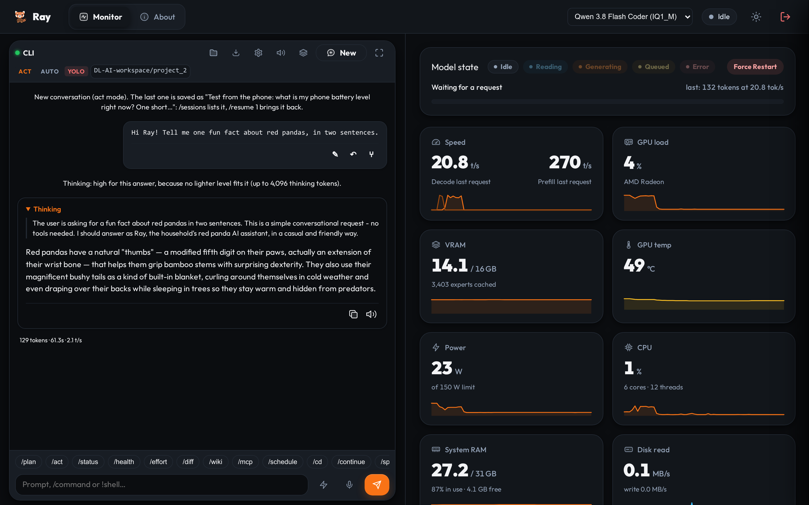
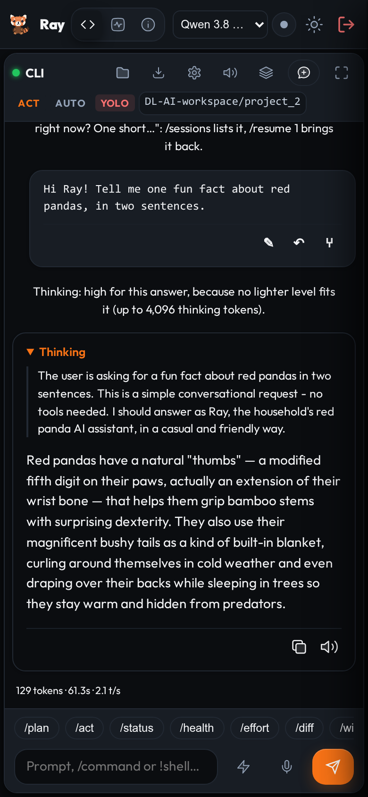
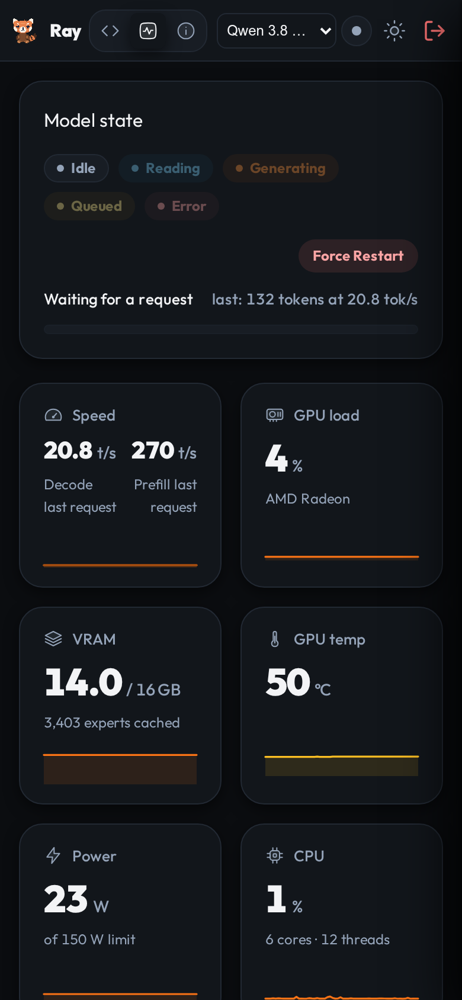
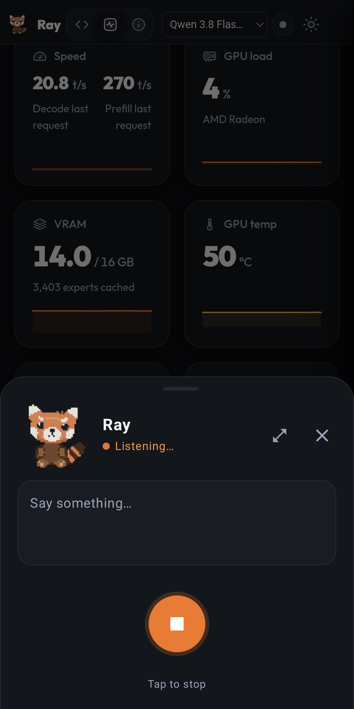
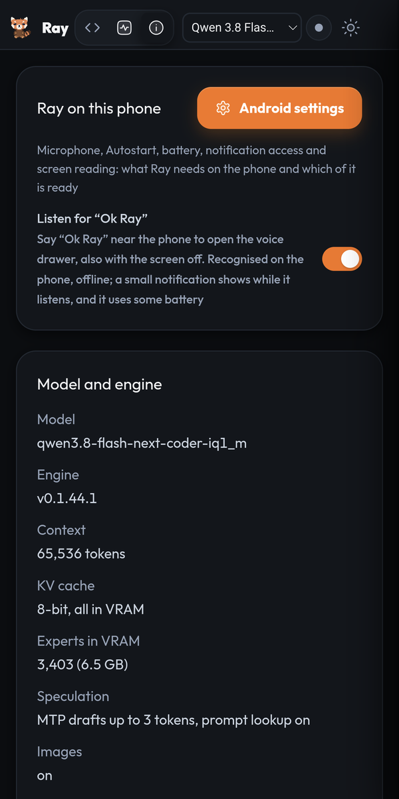
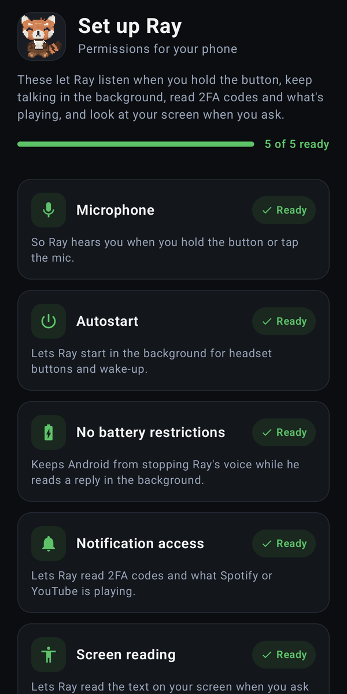

<p align="center"></p>

<h1 align="center">Ray</h1>

<p align="center"><b>A private AI assistant and coding agent that runs on one desktop PC, with no cloud model.</b><br>
Built on <a href="https://github.com/Niko1221/Strata">Strata</a> by <a href="https://github.com/DamirLukina88">Damir</a>.</p>

Ray is the household's little red panda. You type or talk to him in a web app or on your phone, and he answers out
loud, writes and runs code, switches the lights, and looks things up. The model behind him, the 125-billion-parameter
Qwen3.8-Flash-Next Coder, runs entirely on the home PC: an AMD RX 7600 XT graphics card with 16 GB plus 32 GB of
system RAM. Your conversations stay at home.

<p align="center"></p>

<table>
<tr>
<td align="center" width="33%"><br><b>Chat, on a phone</b></td>
<td align="center" width="33%"><br><b>Live monitor</b></td>
<td align="center" width="33%"><br><b>Android voice drawer</b></td>
</tr>
<tr>
<td align="center"><br><b>"Ok Ray" and phone settings</b></td>
<td align="center"><br><b>Setup on the phone</b></td>
<td></td>
</tr>
</table>

## What Ray does

- **Talks with you.** Speak to him and he answers in his own voice. Speech recognition (Whisper) and his voice
  (Piper) run on the PC, so no audio goes to the cloud.
- **Codes with you.** One shared coding-agent session that you can use from the browser and from the terminal. He
  reads and edits files, runs commands and tests, and remembers the plan.
- **Lives on your phone.** An Android app holds the web app and adds a voice drawer. You can open it by holding the
  power button, with a Bluetooth headset or helmet button, or by saying "Ok Ray". He can also use the phone itself:
  battery, flashlight, alarms, media, notifications, the screen and the camera.
- **Runs the smart home.** He works lights, climate, plugs and sensors, 3D printers and cameras through Home
  Assistant.
- **Uses tools.** Around 38 tool servers: web search, mail and drive, translation, maps, weather, papers and more.
- **Shows his work.** You can watch the model think, follow each tool call, and see the GPU, memory and speed live.
- **Is reachable from anywhere.** Remote access goes through a Cloudflare Tunnel behind a login.
- **Has a face.** A red panda drawn in dots sits on the input box. He puts a paw to his chin while thinking, moves
  with his voice, and takes cocoa breaks on long tasks ([meet him](docs/RAY_FEATURES.md#meet-ray)).

**Speed:** about **24 tokens per second** when chatting, and about **335 tokens per second** when reading a long
prompt. Both were measured on the RX 7600 XT above, with the full numbers in [docs/RAY_SPEED.md](docs/RAY_SPEED.md).

## Quick start

You need Linux, a graphics card with 16 GB (AMD with ROCm, or NVIDIA), and 32 GB of RAM.

1. **Install Strata** and pick the Coder model: run `./setup.sh` (see [docs/INSTALL.md](docs/INSTALL.md); on AMD also
   [docs/AMD_HIP.md](docs/AMD_HIP.md)).
2. **Add your keys** to `~/.config/dl-ai/secrets.env` (at least `STRATA_API_KEY`). Nothing secret is stored in this
   repository.
3. **Start the server and Ray's session** as user services:

   ```sh
   cp tools/systemd/dl-ai-sessiond.service ~/.config/systemd/user/
   systemctl --user enable --now dl-ai-sessiond
   ```

4. **Open** `http://127.0.0.1:8080` and say hello.

The full setup (remote access, the commit hook, every command) is in [docs/RAY_SETUP.md](docs/RAY_SETUP.md).

### The Android app

The app is in [android/](android/). Copy `android/secrets.properties.example` to `android/secrets.properties`,
fill in your server's addresses and key, and build it with `./gradlew assembleDebug`. On the phone, make Ray the
digital assistant (Settings → Apps → Default apps), then open **About → Android settings** in the app to grant what
it needs.

## Learn more

| Page | What's in it |
| :--- | :--- |
| [Features](docs/RAY_FEATURES.md) | Ray's animations, the assistant, the coding agent, voice, smart home, every tool server |
| [Setup and use](docs/RAY_SETUP.md) | Installing step by step, remote access, the browser, terminal and API, all commands |
| [Speed](docs/RAY_SPEED.md) | Benchmarks on the RX 7600 XT and the settings behind them |
| [Upstream syncs](docs/RAY_CHANGES.md) | Which Strata releases were merged or ported, and when |
| [How Strata works](docs/HOW_IT_WORKS.md) | The engine underneath: experts, memory, speed tricks ([details](docs/DETAILS.md), [paper](docs/paper)) |

## Privacy and security

- **The model runs at home.** Prompts, answers and the model's thinking stay on the PC. Tools that use online
  services (web search, mail, translation, cloud reasoning) send them only what the task needs, and cloud reasoning
  asks you first.
- **No secrets in the repository.** Keys live in `~/.config/dl-ai/secrets.env`, and a commit hook blocks any commit
  that contains one.
- **Locked down by default.** The web app needs a login or the API key. The Android app gives its key, tools and
  microphone only to your own server's pages, and other apps on the phone can't use Ray's phone tools.

More detail is in the Security part of [docs/RAY_SETUP.md](docs/RAY_SETUP.md).

## Credits and license

Strata, the engine, the server and the installer, is by
[Niko1221 and the Strata contributors](https://github.com/Niko1221/Strata), under the MIT license. The model weights
are Qwen3.8-Flash-Next from Alibaba's Qwen team. Ray, D.L. CLI and the rest of this fork are by
[Damir](https://github.com/DamirLukina88). This fork is licensed under the
[MIT License with Attribution Requirement](LICENSE). Any fork, redistribution, or derivative work of this
repository must credit both upstream [Strata](https://github.com/Niko1221/Strata) (for core engine and architecture) and
[D.L. AI - Strata](https://github.com/DamirLukina88/D.L.-AI---Strata) (for fork development and features). Upstream's own
documentation is in [docs/](docs/), and its paper is in [docs/paper](docs/paper).
