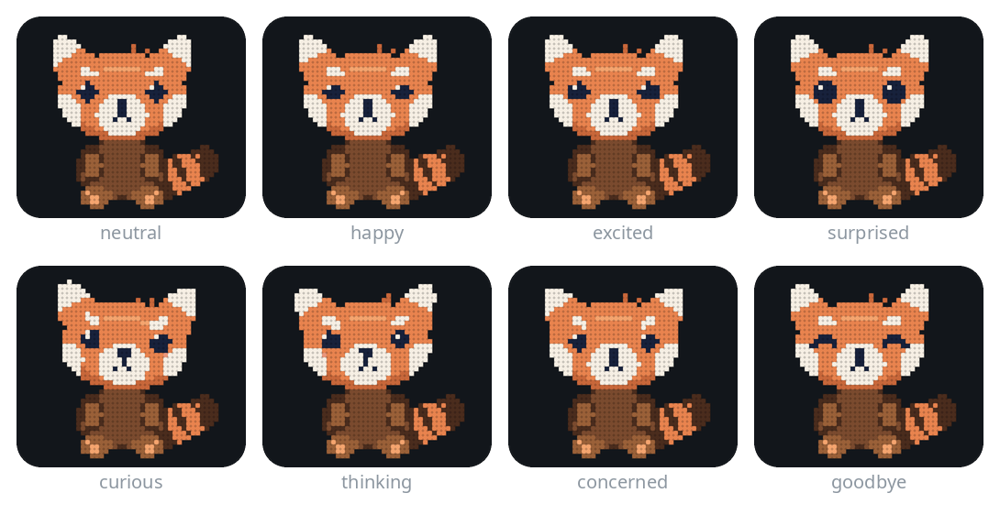

<p align="center"></p>

<h1 align="center">Ray</h1>

<p align="center"><b>The household's little red panda: a private AI assistant and coding agent built on <a href="https://github.com/Niko1221/Strata">Strata</a></b><br>
One desktop PC, no cloud model. Your own model, your own rules.</p>

Ray is the household's little red panda and AI assistant, and he runs entirely on one desktop PC: the 125-billion-parameter Qwen3.8-Flash-Next
Coder model on an AMD RX 7600 XT with 16 GB, plus 32 GB of system RAM. This fork, by
[Damir](https://github.com/DamirLukina88), adds everything around the engine and makes it a workstation you can
reach from anywhere:

- **Ray**, the assistant: the household's little red panda. You talk to him and he answers out loud, with a male
  neural voice and his own casual personality, and in the web app he sits on the input box, thinking and talking
  ([meet him](#meet-ray)). He knows he runs on the home server, not in someone's cloud, and you can reach him from your phone.
- **D.L. CLI**, a coding agent with one shared session you can use from the terminal and from the browser
- **Offline voice:** local Whisper speech-to-text and Piper text-to-speech, with no audio leaving the PC
- **Home Assistant MCP server:** the coding agent switches lights and climate and reads printers and cameras
  (a Gree air conditioner, a Bambu Lab A1 3D printer, Xiaomi cameras, Tuya plugs and sensors)
- a live monitor of the GPU, RAM and engine, and a file workspace on the server
- remote access through a Cloudflare Tunnel over QUIC, behind a Cloudflare Access login

The inference engine is Strata, configured and optimized for AMD RDNA3 (ROCm/HIP). Upstream
Strata releases are continuously evaluated and synced with each release. Upstream 0.2.0-beta and 0.2.1 were
reviewed on 2026-10-20 ([review](wiki/artifacts/upstream-v0-2-releases-review-2026-10-20.md)). From 0.2.2 and 0.2.3/0.2.3.1,
crucial engine, vision, and spec fixes were ported alongside enabling 8-bit hyper-connection weights (`STRATA_HC_Q8=1`)
after an A/B benchmark ([review](wiki/artifacts/upstream-v0-2-3-review-2026-10-23.md)). On 2026-10-25, **v0.2.5** and
**v0.2.6** were synchronized: CommonMark soft linebreaks, direct screenshot clipboard paste (`Ctrl+V`), window-level
drag-and-drop, dynamic model load timeout scaling, safe shard removal guards, `require_messages(messages)` OpenAI-spec
validation, 1-token health check speed guards, and stable GPU hardware telemetry IDs
([v0.2.5 walkthrough](wiki/artifacts/strata-v0-2-5-sync-and-ergonomics-walkthrough.md),
[v0.2.6 & tools walkthrough](wiki/artifacts/davinci-cst-ipc2152-wargaming-and-v026-sync-walkthrough.md),
[system audit](wiki/artifacts/full-workstation-audit-and-verification-2026-10-25.md)). On 2026-10-27, four
**v0.2.7** fixes were ported into engine `0.1.44.1+0.2.7-fixes`:
- a failed read of the per-layer table no longer hangs the next request (#3602);
- a checkpoint copy that runs out of memory is skipped instead of ending the engine (#3350);
- no restore is attempted on a card too full to create its copy stream (#2409);
- an MCP tool name written with `__` collapsed to `_` is read as the declared tool (#3796).

Each was checked with tests and a short smoke test; no benchmark was run
([review](wiki/artifacts/upstream-v0-2-7-review-2026-10-27.md)).

## Meet Ray

Ray is a little red panda drawn in dots. In the web app's Code tab he sits on the top-left edge of the input box, and
he is there only while he has something to do. All the pictures below come from the web app's own drawing code
(`serve/web/rayface.js`), rendered by `tools/make_ray_media.py`. That includes his motion while talking, which follows
real speech in his Piper voice.

<table>
<tr>
<td align="center"><br><b>Thinking</b></td>
<td align="center"><br><b>Talking</b></td>
<td align="center"><br><b>Goodbye</b></td>
</tr>
<tr>
<td>While the model works on your prompt, his paw goes to his chin, his eyes go up and to the side, and question
marks rise. For a typed prompt he leaves as soon as the answer starts.</td>
<td>While he reads a reply aloud, he moves with the loudness of his voice, read 50 ms before it is heard. He squashes
and stretches on syllables, nods on stressed ones, blinks when a thought ends, and his ears and tail follow a beat later.</td>
<td>When he has finished speaking, he gives a happy squint and a small nod, then fades out slowly.</td>
</tr>
</table>

**His moods.** Simple rules on each sentence pick a mood, used at 60% strength and held for at least 2 s, so he never
flickers. A sentence about an error or an apology makes him concerned, one ending in `?` makes him curious, "maybe"
or "hmm" makes him thoughtful, and so on.

<p align="center"></p>

**Cocoa breaks.** Now and then, while the model works, Ray takes a break with a mug of hot chocolate. Once a
think has gone on for 8 s there is a 1 in 3 chance, and it never happens on two thinks in a row. The mug pops up
beside him on the input box, steaming. He picks it up, holds it in both paws and sips with his eyes closed, then
puts it back. Each break picks one of four styles at random, never the same one twice running. If he starts
speaking or the answer arrives, the mug goes away at once.

<table>
<tr>
<td align="center"><br><b>Classic sip</b></td>
<td align="center"><br><b>Slow savour</b></td>
<td align="center"><br><b>Too hot!</b></td>
<td align="center"><br><b>Sips while thinking</b></td>
</tr>
<tr>
<td>One long sip, an "ahh" with an ear wiggle and a short cosy hold.</td>
<td>He cradles the mug under his chin, breathes in the steam and sways gently. Two slow sips with a happy sigh between them.</td>
<td>He blows on it and takes a careful test sip, then jolts: eyes wide, ears up, the mug pulled away. He blows again, then takes the real sip.</td>
<td>He keeps thinking with the mug in both paws, eyes up and question marks rising, and sips now and then.</td>
</tr>
</table>

**At work on long tasks.** When a turn runs long (30 s, or 6 tool calls), Ray works at something that fits the task.
The Code tab tells him the prompt and every tool call, so he knows the kind of work: code, a CAD model, a 3D print or
maths. Three failed tool calls in a turn make it a hard problem. A round is about 35 s, followed by 20 s of plain
thinking, then a new pick at random. The usual activity for each kind of work comes up most often, and none plays
three rounds running. The newest kind of work counts, so a turn that models a part and then prints it moves from
blueprints to measuring between rounds. He only ever holds one prop.

<table>
<tr>
<td align="center"><br><b>Drawing a blueprint</b></td>
<td align="center"><br><b>Measuring a print</b></td>
<td align="center"><br><b>Solving a Rubik's cube</b></td>
<td align="center"><br><b>Working out equations</b></td>
</tr>
<tr>
<td>A blue sheet on his lap. He draws a box with a dimension line dot by dot, nods, wipes the sheet, then draws a gear.</td>
<td>Calipers on a 3D-printed cube. He squints and reads 20.0, measures again, gets 19.9, and a question mark pops up.</td>
<td>He turns rows and columns until the front is all blue, then hops with the cube held up, and it sparkles.</td>
<td>He writes 2x+1 = 7 and taps the pencil on his chin. A light bulb comes on, and on a fresh page he writes x=3 and underlines it.</td>
</tr>
</table>

| Kind of work | What he does (how often) |
| :-- | :-- |
| Code | blueprint 3, equations 1, Rubik's cube 1 |
| CAD and 3D models | blueprint 3, measuring 1 |
| 3D printing | measuring 3, blueprint 1 |
| Maths | equations 3, Rubik's cube 1 |
| A hard problem (3 failed tool calls) | Rubik's cube 3, plus the usual one for the work 1 |
| A long think with no kind of work recognised | a Rubik's cube in 1 round of 3 |

With *reduced motion* set in the system, he takes no cocoa breaks and does no long-task activities. To see them
without waiting, run `RayFace.cocoa("classic" | "savour" | "hot" | "thinking")` or
`RayFace.work("blueprint" | "measure" | "cube" | "maths")` in the browser console while he is thinking.

He has no talking mouth on purpose. Every mouth that copied the speech looked uncanny, so he speaks through motion,
and his mouth opens only on the strongest syllables. His voice is pitched up to 1.5 by default, a little cartoon-like
to suit him. Click him to stop him talking. Two switches in About turn him off: *Show Ray while speaking* and
*Show Ray thinking on every prompt*. The same panda is the app icon and the browser tab icon.

## How fast is it?

Measured on the workstation this fork is built for, with `tools/strata_bench.py` (`bench.sh`):

- **GPU:** AMD Radeon RX 7600 XT, 16 GB (gfx1102, RDNA3), ROCm 7.2 (HIP)
- **RAM:** 32 GB
- **OS:** CachyOS Linux
- **Model:** `qwen3.8-flash-next-coder-iq1_m`, 64K context, int8 KV cache, MTP draft 4

<table>
<tr><td align="center"><b>32.3 tok/s</b><br>peak decode</td>
<td align="center"><b>334.4 tok/s</b><br>16K prompt ingestion</td>
<td align="center"><b>1.62 s</b><br>chat time to first token</td>
<td align="center"><b>25.9 tok/s</b><br>coding-agent decode</td></tr>
</table>

Each column adds switches to the one before it:

| Metric | A: baseline | B: + adaptive overlap | C: + route tail skip 7 | D1: + route resident 0.5 | E: + fusions, coding expert profile | F: + RDNA3 switches, core isolation | v0.1.43.1 / v0.1.45 config | G: v0.2.3 fixes + `STRATA_HC_Q8=1` |
| :--- | ---: | ---: | ---: | ---: | ---: | ---: | ---: | ---: |
| Chat decode (median) | 20.0 tok/s | 20.7 | 22.7 | 21.0 | 20.9 (peak 31.2) | 18.4 (peak 28.0) | 18.3 (peak 29.8) | **24.2** (peak **32.3**) |
| Chat time to first token | 2.03 s | 1.93 | 2.13 | 2.03 | 1.86 | 1.81 | **1.62** | 1.82 (1.66–2.06) |
| 4K prompt ingestion | 258.4 tok/s | 265.9 | 264.2 | 268.1 | 268.1 | 265.8 | 277.2 | **302.8** |
| 16K prompt ingestion | 281.8 tok/s | 285.6 | 283.9 | 286.0 | 288.8 | 291.7 | 289.9 | **334.4** |
| 16K time to first token | 57.0 s | 56.3 | 56.6 | 56.2 | 55.7 | 55.1 | 55.4 | **48.1** |
| Agent decode | 22.8 tok/s | 21.5 | 23.8 | **26.1** | 25.9 | 21.3 | 20.2 | **25.9** (peak **31.0**) |
| Agent turn time to first token | 13.3 s | 13.0 | 12.9 | 12.9 | 12.8 | 12.9 | 12.3 | **11.3** |

Numbers are medians over the bench's runs. The active configuration combines Arm E, Arm F and Arm G: `STRATA_ADAPT_OVERLAP=1`,
`STRATA_ADAPT_OVERLAP_RESIDENT=1`, `STRATA_ROUTE_TAIL_SKIP=7`, `STRATA_ROUTE_RESIDENT=0.5`, fusion and RDNA3 switches,
WMMA prompt GEMMs (`STRATA_HIP_WMMA=1`), the gfx1102 SIMT QSA scorer (`STRATA_SELECT_SIMT=1`), Q8_0 hyper-connection weights
(`STRATA_HC_Q8=1`), core isolation (`STRATA_AUX_CPUS=auto`), and a custom expert profile built
from coding traces with `tools/make_profile_mix.py`.

## What it adds to Strata

### 1. Ray, the Assistant
The coding agent is Ray, in the web app's Code tab and in the terminal (the separate Chat tab was removed on
2026-10-23):
- **Who he is:** the household's little red panda, AI assistant and coding agent: casual and direct, with a light sense of humour. He never calls
  you "sir" or "madam", and he doesn't assume who is talking: anyone in the house or a guest may be. He uses a name
  only once someone gives it, and he credits the builder only when asked who made him. His identity note says who
  built what, that he runs on "the home server" (not "this PC", which sounds wrong from a phone), and that the model
  weights come from Alibaba's Qwen team, who neither run him nor see anything he does. Without it, the model credits
  everything to Alibaba.
- **Talk to him:** speech-to-text often mangles his name (Rey, Rae, Wray, Ring); he answers anyway, without
  correcting the spelling, and greetings and small talk get an answer without tool calls. A spoken prompt gets a note
  to answer in plain speech (no tables, code blocks, emoji or URLs, numbers said as words) at full length, and the
  answer is read back in the male Piper HFC voice. A typed prompt gets a normal written answer.
- **Fast spoken answers:** with default automatic thinking (`/effort auto`), greetings, wake words, and household commands answer right away with thinking off, while deep questions and coding turns get appropriate reasoning automatically.
- **Checked with a benchmark:** `tools/ray_persona_bench.py` asks him 22 fixed questions (who is talking, being
  addressed, who made him, persona, spoken answers, and the machine, folder, time and smart home through his tools)
  and scores the answers ([results and method](wiki/artifacts/ray-persona-bench-2026-10-23.md)).

### 2. Unified Shared CLI & Autonomous Coding Agent
The coding agent runs in a persistent background daemon (`tools/dl_sessiond.py`). Both the web app's **Code** tab
and `dl_cli.py --attach` in a terminal are clients of the same session, allowing you to start a task on your phone
and seamlessly inspect or continue it from your terminal:
- Native Markdown formatting, folding reasoning streams, and expandable tool cards.
- **Approvals for destructive actions:** recursive deletes, `sudo`, disk tools, git history rewriting, and writes outside workspace require explicit Approve/Deny.
- **YOLO Mode & Infinite Continuation:** `/yolo` disables approval prompts per session and enables infinite autonomous auto-continuation past `DL_MAX_TURNS` for complex workflows.
- **Saved conversations:** `/clear` and the **New** button save the conversation they end, so nothing is lost.
  - `/sessions [words]` lists the saved ones, newest first, and searches their titles and messages. `/resume N` brings one back after saving the current one. `/rename` and `/delete N` change the list; deleted ones go to a `.deleted` folder.
  - In the Code tab, the **Sessions** drawer does the same.
  - They are kept in `~/.local/state/dl-ai/archive/<session>/` and shared by the web app and the terminal ([decision](wiki/decisions/saved-cli-sessions.md)).
- **Edit, rewind and branch:** every past prompt in the Code tab has ✎ Edit, ↶ Rewind and ⑂ Branch buttons; in the terminal, `/prompts` numbers the prompts.
  - `/edit N <text>` replaces prompt N and runs the new text.
  - `/rewind N` goes back to just before prompt N (it and what followed are removed).
  - `/branch N [text]` keeps the whole conversation in Sessions and goes on from before prompt N.
  - A prompt that context trimming already removed cannot be gone back to; the command says so and changes nothing.
- **The feed lets you read:** while an answer streams, scrolling up (wheel, finger or PageUp) stops the feed from following, and scrolling back to the bottom resumes it. A message you send always scrolls into view.
- **Stop and Clear respond at once:** Stop closes the model request immediately, also while the engine is still reading a long prompt or the request waits behind another one (measured 1.0 s against a silent test server; before, it waited for the server's next 10 s heartbeat). The Code tab reconnects a live stream that died silently (phone asleep, Wi-Fi or tunnel dropped), so Clear and Stop no longer look stuck until you switch tabs.
- **Plan Mode:** `/plan` investigates read-only and presents an *Execute this plan?* prompt to transition cleanly into act mode.
- **Automatic Thinking Level (`/effort auto`):** default per-turn thinking selector (`tools/dl_effort.py`) that picks `none` for greetings, wake words and smart-home/clock commands, `low` for short factual questions, `medium` for conceptual explanations, and `high` for code, files, errors, plan mode, or follow-up complaints—and escalates mid-turn to `high` if any tool call errors, repeats, or hits a retry guard ([decision](wiki/decisions/auto-thinking-level.md)). Configurable via the Settings/Sampling drawer or `/effort auto|none|low|medium|high` (`/effort default` is auto).
- **Dynamic Reasoning Budget Capping:** tiered token caps (`none: 0`, `low: 1024`, `medium: 2048`, `high: 4096`) passed in `reasoning_budget_tokens` eliminate runaway loops without clipping solutions. On mid-turn escalation, the budget automatically raises to 4,096 tokens alongside effort to `high`.
- **Empirical Response Matrix & CPU Semantic Router:** a 75-item evaluation suite (`tools/bench_effort_matrix.py`) across Voice, Chat, and Coding cohorts and a zero-dependency CPU difficulty router (`tools/dl_effort_scorer.py`, 0.09 ms latency, deterministic CRC32 feature hashing, cosine $k$-NN, safety upward bias).
- **Conversational Continues:** naturally typing *"continue"*, *"keep going"*, or *"go on"* routes directly to turn continuation.

**Keeps its task on long runs** (added 2026-10-20, after a 6-hour run lost its task to context trimming):
- **Trim protection:** when the 64K context is trimmed, your own messages are kept; the CLI's own notes no longer push the task out.
- **The plan is a file:** an approved plan is saved as `PLAN.md` with a `## Progress` checklist that the agent ticks line by line as each check passes. `/planfile <path>` attaches an existing plan. The Code tab shows the progress as a chip (`PLAN 12/34`, red `BLOCKED`).
- **Memory files in the prompt:** `AGENTS.md` (and `CLAUDE.md` where it differs), the wiki's page list and the plan's Progress are part of the system prompt. They are rebuilt only at the start of a request and after a trim, so the engine's prompt cache keeps working.
- **Checks before it may stop:** the done check (in YOLO it sends the agent back until the plan is done or has a `Blocked:` line, and stops after three tries with no change), a browser check (the changed page is loaded in headless Chromium and its console errors go back to the agent), an evidence check ("tests pass" with no test run after the last edit), and one fresh-context review of the diff. Each can be turned off: `DL_DONE_CHECK=0`, `DL_BROWSER_CHECK=0`, `DL_EVIDENCE=0`, `DL_REVIEW=0`.
- **Thinking-loop guard:** a thinking stream that keeps repeating itself is stopped, and the agent is asked for its next action (`DL_LOOP_GUARD=0` turns it off).
- **Undo for every edit** (added 2026-10-20, after a shell-command edit emptied a 33 KB game file): every round that changes files is committed to a git history kept outside the workspace (`~/.local/state/dl-ai/checkpoints/`; `DL_CHECKPOINTS=0` turns it off). A call that empties, deletes or halves a file says so in its result, with the command that restores it (`DL_SHRINK_ALARM=0`). An edit that would copy a trim stand-in (`[N chars removed by D.L. CLI ...]`) into a file is refused. A tool result over 30,000 characters reaches the model as its start and end (`DL_TOOL_RESULT_MAX`), so one long debug print can no longer overflow the context and end a run.
- **Full transcript:** the session daemon writes every event (messages, thinking, tool calls and results, notices) to `~/.local/state/dl-ai/transcripts/<session>/<date>.jsonl` (`DL_TRANSCRIPT=0` turns it off). `/save full` exports the whole run since `/clear`; plain `/save` has only what is still in the context.
- **Checks that see the whole run:** the browser check also finds pages a build script writes, and it runs at every YOLO auto-continue, not only when a request ends. The fresh-context reviewer reads every change since the request started, shell-command edits included (from the checkpoints). Its findings are shown on the Code tab, and its note survives trimming while the agent works through it.
- **Measured** with `tools/dl_agent_bench.py` on a 12-step task with the context squeezed to force 15 trims: before, the task and the plan were trimmed away (2 of 3 checks, 186 tool calls, 56 min); after, 3 of 3 checks with `PLAN.md` kept, 105 tool calls, 50 min. One run each; details in [the wiki](wiki/decisions/dl-cli-task-memory-and-finish-checks.md).

### 3. Local Whisper Speech-to-Text (STT) & Hands-Free Auto-Send
Dictate prompts privately with 100% offline speech recognition:
- **Local Whisper Engine:** runs on the PC host via `whisper.cpp` (`ggml-base.bin`) through `POST /v1/audio/transcriptions` with zero cloud leaks.
- **Real-Time Interim Speech:** progressive interim speech population renders in the composer while walking or talking.
- **Dual-Mode Voice Typing:** click to toggle recording, or hold-to-talk with visual recording pulse.
- **Instant Auto-Send (0ms Delay):** hands-free auto-send populates the text field and submits immediately upon speech pause.
- **Fast spoken responses:** spoken prompts use `/effort auto` by default, answering greetings and home commands instantly while giving complex queries full reasoning room.
- **Mobile Keyboard Suppression:** taps on voice triggers call `navigator.virtualKeyboard.hide()` and set `inputmode="none"`, preventing smartphone on-screen keyboards from obscuring the screen.
- **Browser Speech Fallback:** Web Speech API fallback available when local Whisper is uninstalled.

### 4. Native Browser Text-to-Speech (TTS) & Neural Piper
Listen to responses hands-free without third-party audio streaming:
- **Voice-Gated Auto-Speak:** *"Automatically read new answers aloud"* (on by default) speaks replies only when the input was dictated via STT, preserving silence when typing.
- **20 US Neural Piper Voices:** high-quality local Piper speech synthesis integrated via Linux Speech Dispatcher and Web Speech API. Ray's voice, `en_US-hfc_male-medium` (male since 2026-10-28), is the default on the server, in the browser and on the desktop; any other voice can be picked in Settings. Where the server voice is off and Piper is missing (Edge, macOS), *Auto* picks a male voice by name (Edge's Andrew or Guy, Chrome's Google UK English Male); Android names voices by language only, so there it is the local US English voice.
- **Ray's voice from the server:** `POST /v1/audio/speech` (OpenAI-style `input`, `voice`, `speed`; WAV, `serve/speech.py`) runs Piper on the home server, so phones hear the same voice as the PC (measured 0.39 s for 3.4 s of speech). The web app uses it by default (About: *Use Ray's voice from the server*) and falls back to the browser voice if it fails.
- **Ray's avatar:** a little red panda sitting on the input box who thinks while the model works and moves with his voice while he reads a reply aloud ([Meet Ray](#meet-ray)). Now and then he takes a cocoa break, and on long tasks he works at something that fits: a blueprint, calipers on a 3D print, a Rubik's cube or equations. Click him to stop the speech. Turn him off in About.
- **Speed and pitch:** the sliders in About work for the server voice and the browser voice. Piper has no pitch setting, so pitch is made by playing the speech faster, which was asked from the server that much slower, so the pace stays at the Speed setting. The default pitch is 1.5.
- **Natural Speech Cleaner (`cleanForSpeech`):** strips markdown, emojis, code blocks, box borders, and converts math, units, and symbols to natural spoken words.
- **Mobile Keep-Alive & Controls:** Android Screen WakeLock and MediaSession notification drawer controls (play, pause, stop).

### 5. Home Assistant Smart Home MCP Server
A built-in Model Context Protocol (MCP) server (`tools/homeassistant_mcp.py`) exposes your smart home to the coding agent (the Code tab and the terminal CLI). It runs here with lights on Tuya smart plugs, a Gree air conditioner, a Bambu Lab A1 3D printer and two Xiaomi cameras:
- Direct entity control: lights, switches, media players, climate units (Gree AC), covers, and smart plugs.
- Rooms: entities carry their Home Assistant area, so "turn off the living room lights" finds every light there, plug-powered ones included.
- Live camera snapshots: captures and saves camera feeds to the workspace for multimodal inspection.
- Jinja2 template rendering and entity state history lookups.
- Interactive MCP tools explorer in the web GUI via `/mcp`.
- Loads when it is needed, not by default: when your message mentions the smart home, or when the agent turns it on itself.

### 6. Tools and MCP Servers (38 servers)

**Always there.** Ray's own tools are in every request:
- `run_command`, `view_file`, `write_to_file` and `replace_file_content` work on files and the shell in the workspace.
- `switch_workspace` changes the folder he works in.
- `local_wiki` reads and saves the project's `wiki/`.
- `get_system_health` and `get_engine_status` report the PC and the engine.
- `save_chat` and `clear_conversation` manage the conversation.
- `mcp` turns the servers below on and off.

Plan mode (`/plan`) gets the read-only ones.

**On demand.** Every tool description is sent again with every turn, and the local model pays for it in prompt time.
So the 38 MCP servers in `~/.config/dl-ai/mcp.json` stay off until a request needs them (`tools/dl_mcp.py`):
- **They turn on by themselves:** a server starts when your message matches its trigger words (English, Croatian and
  German), or when Ray turns it on with his `mcp` tool. One whose tools go unused for 3 turns is turned off again.
- **A cap on tools at once:** 25 by default (`max_tools`; 45 on this PC); past it, the server used longest ago goes
  first.
- **By hand:** `/mcp` lists them all, with `/mcp on NAME` and `/mcp off NAME` to switch one. The Code tab shows the
  ones that are on as chips.
- **Approvals:** tools that send or share something (email, Drive sharing, a cloud call) show an approval card first.
  `/mcp trust NAME` stops the card for the session, and `/mcp ask NAME` brings it back.
- **Keys stay narrow:** each server gets only the keys it names from `~/.config/dl-ai/secrets.env`, never the whole
  file.
- **Errors reach the thinking level:** every server answers `ping`, and a failed call is marked `isError`, so the
  automatic thinking level sees tool failures.
- **Four are part of Ray himself, with no separate program:** `exa`, `deepl`, `proton` and `schedule`.

| Group | Servers | What they cover |
| :--- | :--- | :--- |
| **Ray himself** | `ray_identity` | Who Ray is, plus this PC's hardware, the running engine's address, model and settings, the services and the git status. All of it is read when he is asked, so nothing hardcoded can go stale. Also the MCP catalogue. |
| **Smart home and jobs** | `homeassistant`, `schedule` | Lights, plugs, the Gree air conditioner, Bambu Lab A1 printer, Xiaomi cameras and air purifier, Zigbee sensors ([section 5](#5-home-assistant-smart-home-mcp-server)). Jobs: a prompt or one exact action at a set time or on repeat (reminders, daily summaries). |
| **Cloud reasoning** | `deepseek` | DeepSeek for heavy maths and long proofs. Every call shows an approval card with the full prompt that would leave the PC. The key comes only from `DEEPSEEK_API_KEY`. |
| **Web, mail and documents** | `exa`, `fetch`, `playwright`, `deepl`, `proton`, `gmail`, `drive`, `docs` | Exa web search, reading a page as Markdown, and a real headless browser that can click and fill forms. DeepL translation of texts, HTML emails and workspace files. Proton Mail through Bridge, Gmail, Google Drive and Google Docs: search, read, draft, and send or share after approval. |
| **Programming** | `context7`, `modernweb`, `rfc`, `osv`, `devstandards` | Up-to-date library docs (Context7), modern HTML and CSS guidance, IETF RFCs, known vulnerabilities in PyPI, npm, Go and crates.io packages (OSV), game programming patterns and MDN. |
| **Knowledge and science** | `wikipedia`, `arxiv`, `openalex`, `europepmc`, `pubchem`, `clinicaltrials`, `opentargets`, `reactome` | Wikipedia overviews, arXiv preprints, OpenAlex (250M+ scholarly works), Europe PMC open-access papers, PubChem chemistry, ClinicalTrials.gov studies, Open Targets drug targets, Reactome pathways. |
| **Making things** | `solidcraft`, `print3d`, `cadmaterials`, `electronics`, `networking`, `minipaint` | SolidCraft parametric 3D CAD modeling & engine control (parametric enclosures, brackets, flanges, standoffs, custom sketches/extrusions/cuts, automatic `.solidcraft`/`.step`/`.stl`/`.3mf` export and GPU-rendered PNG snapshots saved directly into Ray's workspace, live GUI control via port 7878), Klipper G-code & Bambu/Prusa filament presets, STEP AP242/IGES & AFLOW material properties, miniature painting & wargaming (3,340+ paint conversions across Citadel, Vallejo, AK, Army Painter, airbrush thinning, NMM/slapchop, Warhammer 40k / Kill Team wound matrix, AP saves, FNP, faction color schemes & BGG mechanics), electronics & components (IPC-2152 PCB trace width & current capacity, copper weight, thermal rise, ESP32/RP2040 decoupling capacitor rules, LCSC/JLCPCB parts, SMD resistor code decoder), networking & LAN (SFP/SFP+/QSFP optics, OM3/OM4/OS2 fiber standards, RJ45 T568A/B cabling, PoE, IEEE MAC vendor lookup). |
| **Photo, video, audio and drones** | `photovideo`, `drones` | Exposure & 180° cinematic shutter calculations, camera log profiles (Sony S-Log3, Canon C-Log3, DJI D-Log, Panasonic V-Log), DaVinci Resolve Color Space Transform (CST) node tree workflow (DWG / DaVinci Wide Gamut intermediate, Rec.709 delivery, QuickTime gamma tags, shortcuts), storyboard shot composition (ELS, LS, MCU, CU, OTS, Dutch angles), audio engineering loudness targets (YouTube/Spotify -14 LUFS, Broadcast EBU R128 -23 LUFS, Podcasts -16 LUFS, True Peak), mic polar patterns (shotgun, lavalier, cardioid), 32-bit float audio, DJI drone hardware specifications (Mini 4 Pro, Air 3, Mavic 3 Pro), CCAA & EASA Croatian drone laws, and Croatia Control AMC Portal automated airspace booking (Zagreb LDZA CTR). |
| **Places, laws and live data** | `osm`, `weather`, `laws`, `zagreb`, `croatia_live` | OpenStreetMap geocoding, Open-Meteo live weather for any city, Croatian (Zakon.hr, Narodne novine) and EU (EUR-Lex, CURIA) laws. Zagreb and Croatia: ZET tram lines (ends from ZET's own GTFS feed; day 1-17, night 31-34) & live disruption alerts (zet.skoljka.org), BAJS (Nextbike) live bike availability across all 200 stations in Zagreb, on-duty pharmacies (the City of Zagreb's list, with its date), specialized emergencies (Poison Control CKO, pediatric ER Klaićeva/Rebro, vet clinic VetFak, dental emergency), where to look up Čistoća's waste schedule for an address, real-time Zagreb air quality (European AQI, PM2.5, PM10), HAK live highway/border conditions (A1/A3, Lučko, Bregana, Macelj, Bajakovo), official DHMZ meteorological observations, HNB official exchange rates (EUR/USD/BAM/CHF/GBP), state holidays & non-working Sunday shopping rules (Zakon o trgovini), current fuel prices (median over every station in the Ministry of Economy's price register, read live), and Zagreb LDZA aviation METAR. |

Separate from Ray, Strata has its own MCP server for installing and running the engine from another AI app
([docs/MCP_SERVER.md](docs/MCP_SERVER.md)).

### 7. Workspace, JIT Model Loading & Remote Access
- **Server File Workspace:** upload files by drag and drop, browse folder trees, stream and resume large downloads.
- **JIT Model Loading & Memory Hygiene:** models load on demand and unload after 8 hours idle. `STRATA_DROP_CACHE_ON_EXIT=1` returns Linux page cache (20+ GB) immediately on exit.
- **Zero-Port Remote Access:** Cloudflare Tunnel over QUIC publishes the app, authenticated via Cloudflare Access JWT.

## Install

1. **Install Strata itself** as upstream describes it in [docs/INSTALL.md](docs/INSTALL.md) (on AMD, see also
   [docs/AMD_HIP.md](docs/AMD_HIP.md)). Use `./setup.sh` on Linux and pick the Coder model.

2. **Create the secrets file** `~/.config/dl-ai/secrets.env` (mode 600). Nothing secret is stored in this
   repository:

   ```sh
   STRATA_API_KEY=<a long random string, e.g. python3 -c "import secrets; print(secrets.token_hex(24))">
   EXA_API_KEY=<your Exa key>                 # optional: web search
   CONTEXT7_API_KEY=<your Context7 key>       # optional: library docs
   HASS_URL=http://127.0.0.1:8123             # optional: Home Assistant smart home
   HASS_TOKEN=<your Long-Lived Access Token>  # optional: Home Assistant
   STRATA_CF_ACCESS_TEAM=<your Zero Trust team name>
   STRATA_CF_ACCESS_AUD=<the Access application's Audience tag>
   ```

3. **Run the server and the session daemon as user services.** Point the server's unit at the secrets file with
   `EnvironmentFile=%h/.config/dl-ai/secrets.env`. Then install the session daemon:

   ```sh
   cp tools/systemd/dl-ai-sessiond.service ~/.config/systemd/user/
   systemctl --user daemon-reload
   systemctl --user enable --now dl-ai-sessiond
   ```

4. **Remote access (optional).** Create a Cloudflare Tunnel to `http://localhost:8080` with QUIC protocol. Add an Access application
   for its hostname, with a Bypass policy for `/v1/*` if API clients connect from outside. Copy the application's
   **Audience (AUD) tag** into `STRATA_CF_ACCESS_AUD`.

5. **Install the secret-scanning commit hook** in your clone:

   ```sh
   ln -sf ../../tools/pre-commit-scan-secrets.py .git/hooks/pre-commit
   ```

## Using it

- **Browser:** open the app (`http://127.0.0.1:8080` locally, or your tunnel hostname).
  - **Code:** Ray, the shared coding agent, with voice typing, read-aloud TTS, and workspace files (*Attach* adds an
    `@path` reference to the prompt). **Sessions** opens the saved conversations, and **New** starts a new one (the
    current one is saved). From 1,200 px wide, Code and Monitor or About sit side by side with a draggable divider.
  - **Monitor:** real-time GPU, VRAM, RAM, and KV cache monitoring.
- **Terminal:** run `python3 tools/dl_cli.py --attach` to join the shared session, and `/detach` to leave it
  running.
- **Commands** (in either client):

  | Command | What it does |
  | :--- | :--- |
  | `/plan`, `/act` | switch between plan mode and act mode |
  | `/yolo` | turn approvals off and enable infinite continuation |
  | `/continue` | continue execution of multi-turn assistant plans |
  | `/planfile <path>\|off` | attach a plan file the agent works from and ticks (`PLAN.md`) |
  | `/effort none\|low\|medium\|high\|auto` | this session's reasoning effort (`auto`, the default, picks per turn and escalates on tool failures; `/effort default` is auto) |
  | `/cd <path>` | change the project folder |
  | `/status`, `/health` | engine status, hardware health |
  | `/mcp`, `/mcp on\|off <server>` | list the MCP servers, turn one on or off |
  | `/mcp trust\|ask <server>` | stop or resume a server's approval card for this session (e.g. DeepSeek) |
  | `/speak` | read the latest assistant message aloud |
  | `/exa <query>`, `/context7 <library>` | web search, library docs |
  | `/diff`, `/secrets`, `/test`, `/wiki` | review the diff, scan for secrets, run tests, search the wiki |
  | `/save` | save the chat as Markdown |
  | `/clear`, `/new` | start a new conversation; the current one is saved |
  | `/sessions [words]` | saved conversations, newest first; words search titles and messages |
  | `/resume N`, `/delete N` | bring a saved conversation back, or remove it from the list |
  | `/rename [N] <title>` | name this conversation, or saved conversation N |
  | `/prompts` | this conversation's prompts, numbered |
  | `/edit N <text>`, `/rewind N`, `/branch N [text]` | replace prompt N, go back to before it, or branch from before it |
  | `!<command>` | run a shell command |

- **API:** the server speaks the OpenAI and Anthropic APIs on `/v1` (`/v1/chat/completions`, `/v1/audio/transcriptions`). Send the key as `Authorization: Bearer`.

## Security

- **No secrets in the repository.** Keys live in `~/.config/dl-ai/secrets.env`, and the pre-commit hook blocks a
  commit that contains one. It also blocks added lines that carry this machine's home path, the folder the checkout
  sits in, or the profile's email address; it reads those at run time, so the hook names none of them.
- **What goes online.** The model and its thinking stay on the PC. Tools that use online services send those services
  what a task needs: web search, Gmail, Google Drive, Proton Mail, DeepL, DeepSeek, and lookups such as weather or
  Wikipedia. DeepSeek, which gets your text for cloud reasoning, asks on a card before every call unless you typed
  `/mcp trust deepseek` for the session.
- **Browser requests** need a valid Cloudflare Access token (signature, issuer, audience and expiry are checked)
  or the API key. Keys are never accepted in URLs.
- **The session daemon** listens only on a Unix socket in your runtime directory (mode 600).
- **Workspace file access** is confined to the workspace directory.

## Credits and license

Strata, the engine, the server and the installer, is by
[Niko1221 and the Strata contributors](https://github.com/Niko1221/Strata), under the MIT license. The model weights
are Qwen3.8-Flash-Next from Alibaba's Qwen team. Ray, D.L. CLI and the rest of this fork are by
[Damir](https://github.com/DamirLukina88). This fork keeps
that license ([LICENSE](LICENSE)). Upstream's own documentation is in [docs/](docs/), and its paper is in
[docs/paper](docs/paper).
