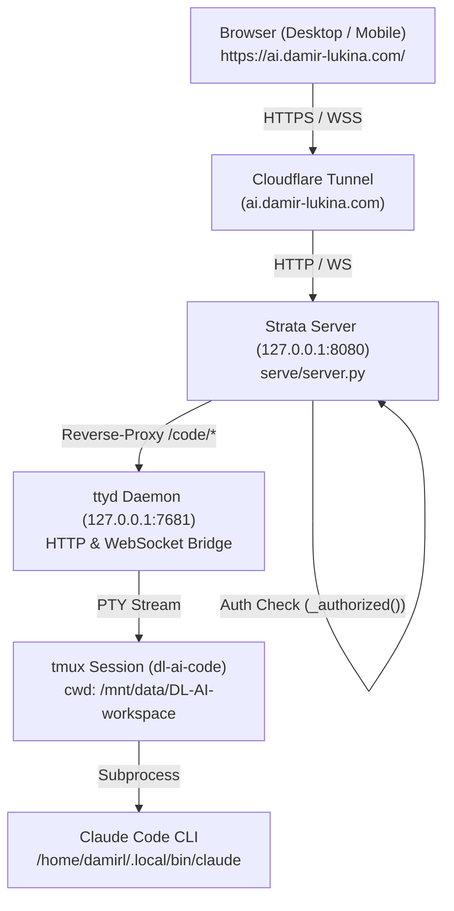

# Implementation Plan: Claude Code Web Interface on Host

Integrate an interactive, persistent web interface for the **Claude Code CLI** into the D.L. AI web app ([https://ai.damir-lukina.com/](https://ai.damir-lukina.com/)). The new interface lives as a dedicated **"Code"** tab in the main navigation bar (between **Chat** and **Monitor**), authenticated transparently using the existing Strata session and API key, and backed by a persistent `tmux` session inside the shared `/mnt/data/DL-AI-workspace` directory.

---

## 1. Goal Description

- **Remote Coding from Web Browser:** Enable the user to code remotely using the Claude Code CLI (`/home/damirl/.local/bin/claude`) from desktop and mobile browsers.
- **Local Strata Inference by Default (No Cloud Models):** The CLI is hardwired to use the local Strata server (`http://127.0.0.1:8080`) by default via `ANTHROPIC_BASE_URL="http://127.0.0.1:8080"` and `ANTHROPIC_AUTH_TOKEN`. It executes all coding tasks using Strata's local **Qwen3.8-Flash-Next Coder** model, ensuring 100% private, free, on-device inference with zero external cloud calls.
- **Unified Authentication:** Access to the terminal is guarded by the Strata server's authentication layer (`serve/server.py`). Only requests with valid API keys / session tokens are permitted. No open, unprotected ports.
- **Persistent Sessions (via `tmux`):** Claude Code runs inside a dedicated `tmux` session (`dl-ai-code`) in `/mnt/data/DL-AI-workspace`. Closing the browser tab, refreshing, or sleeping a mobile phone will **not** terminate Claude; reconnecting instantly resumes the running session.
- **Native Navigation Integration:** A new tab labeled **"Code"** with a code/terminal icon (`</>`) is placed directly between "Chat" and "Monitor".
- **Hierarchical Server Workspace with Collapsible Folders:** When folders are dropped or created in the workspace, files are neatly organized into collapsible folder sections (with expand/collapse chevrons, file counts, and folder actions), supporting full recursive folder upload on drag-and-drop.

```
┌─────────────────────────────────────────────────────────────────────────────────┐
│ D.L. AI   [Chat]  [Code (New)]  [Monitor]  [About]   [Model: Qwen...]  [Status] │
├─────────────────────────────────────────────────────────────────────────────────┤
│ ┌─ Code Terminal Bar ─────────────────────────────────────────────────────────┐ │
│ │ 🟢 Claude Code CLI   Session: dl-ai-code • /mnt/data/DL-AI-workspace  [⟳] [⛶]│ │
│ └─────────────────────────────────────────────────────────────────────────────┘ │
│ ┌─ Interactive xterm.js Terminal (ttyd + tmux) ───────────────────────────────┐ │
│ │                                                                             │ │
│ │  Claude Code (v2.1.296)                                                     │ │
│ │  cwd: /mnt/data/DL-AI-workspace                                             │ │
│ │                                                                             │ │
│ │  > What would you like to build?                                            │ │
│ │                                                                             │ │
│ └─────────────────────────────────────────────────────────────────────────────┘ │
└─────────────────────────────────────────────────────────────────────────────────┘
```

---

## 2. Architecture & Technical Design



### Key Components

1. **Terminal Backend (`ttyd` + `tmux`):**
   - Package `ttyd` (v1.7.7) and `tmux` (v3.8) run on the host.
   - `ttyd` runs bound **only** to `127.0.0.1:7681` with `-b /code` (base path) and `-W` (writable).
   - Command executed: wrapper script `tools/run-code-session.sh` that attaches to or creates the `tmux` session `dl-ai-code` in `/mnt/data/DL-AI-workspace`.
   - Managed as a `systemd --user` service: `claude-terminal.service`.

2. **Strata Reverse-Proxy & Security Layer (`serve/server.py`):**
   - Intercepts all requests matching path `/code` and `/code/*`.
   - Enforces `self._authorized()`. Any unauthenticated request is rejected with `401 Unauthorized`.
   - **HTTP Proxying:** Proxies static files and initial HTML/JS from `127.0.0.1:7681` to the client.
   - **WebSocket Tunneling:** When client initiates WebSocket handshake (`Upgrade: websocket` to `/code/ws`), Strata establishes a direct TCP socket to `127.0.0.1:7681`, completes the handshake, and pipes raw bidirectional traffic until disconnect.
   - Preserves `/code/token` public response so `ttyd` reconnection loop does not fail.

3. **Frontend UI (`serve/web/`):**
   - **Header Tab:** Adds `<button class="st-tab" id="tab-btn-code" data-tab="code">` between Chat and Monitor.
   - **Code View:** Contains `<section class="view view--code" id="view-code">` hosting an embedded terminal frame with session controls (Restart, Fullscreen, Status badge).
   - **Lazy Loading:** Terminal iframe loads only when the "Code" tab is first activated.
   - **Responsive Design:** Terminal container fills 100% available viewport height with full mobile touch keyboard support.

---

## 3. Implementation Summary

1. **Service Configuration:**
   - Wrapper script: `tools/run-code-session.sh`
   - User service: `~/.config/systemd/user/claude-terminal.service`
2. **Reverse Proxying & APIs in `serve/server.py`:**
   - Added raw WebSocket TCP tunnel for `/code/ws` with threading.
   - Added `POST /api/code/restart` sending `tmux respawn-pane -k -t dl-ai-code:0.0`.
   - Added bypass for `ttyd`'s `/code/token` endpoint.
3. **Frontend Updates in `serve/web/`:**
   - `index.html`: added Code navigation tab and terminal container.
   - `app.js`: added tab switching, iframe lifecycle, restart handler, and keyboard shortcuts.
   - `style.css`: added theme-aware styling, scrollbar rules, and fullscreen mode.

## Sources

- Tool: Antigravity pair programming session
- Session ID: `44aeb44c-4179-41a4-b503-f0e55de2e0a8`
- Date: 2026-10-10
