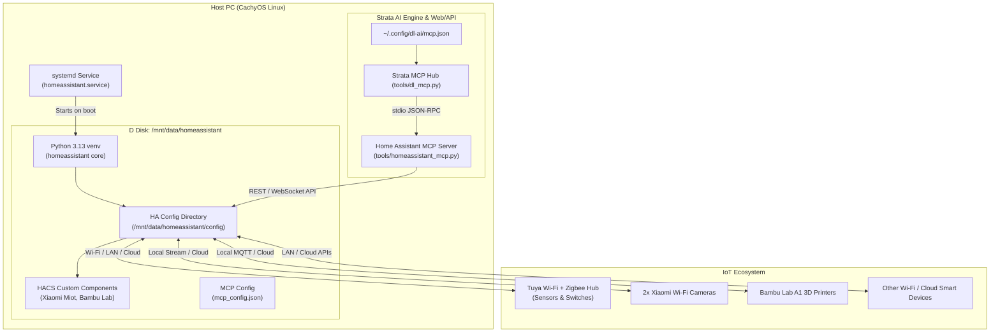

# Implementation Plan: Home Assistant Core & Strata MCP Integration

Deploy Home Assistant Core in a dedicated Python virtual environment on the D disk (`/mnt/data`), configure it to start automatically on system boot via systemd, prepare integrations for all IoT devices (Tuya Wi-Fi/Zigbee hub, Xiaomi Wi-Fi cameras, Bambu Lab A1 3D printers, and HACS), and create a native MCP server for Strata to inspect and control Home Assistant devices.

## Proposed Architecture



---

## User Review Required

> [!IMPORTANT]
> 1. **Initial Web Onboarding**: Home Assistant requires a one-time initial admin account creation via `http://localhost:8123` upon first boot. Once created, you will generate a **Long-Lived Access Token** in your profile settings to paste into `/mnt/data/homeassistant/mcp_config.json`.
> 2. **Device Credentials**: Connecting Tuya, Xiaomi Miot, and Bambu Lab requires entering your account credentials / device IP addresses in the Home Assistant integrations dashboard.

---

## Proposed Changes

### 1. Host Prerequisites & Dedicated Home Assistant Core Setup

Installed isolated Python 3.13 virtual environment using `uv` on `/mnt/data/homeassistant`, and installed Home Assistant Core and necessary system build tools (`ffmpeg`, `libturbojpeg`).

- **Base Directory**: `/mnt/data/homeassistant`
- **Virtualenv**: `/mnt/data/homeassistant/venv`
- **Config Directory**: `/mnt/data/homeassistant/config`
- **Service User**: `damirl`

#### `/etc/systemd/system/homeassistant.service`
A systemd service configured to start Home Assistant Core automatically at boot after network is online:
```ini
[Unit]
Description=Home Assistant Core
After=network-online.target

[Service]
Type=simple
User=damirl
WorkingDirectory=/mnt/data/homeassistant/config
ExecStart=/mnt/data/homeassistant/venv/bin/hass -c /mnt/data/homeassistant/config
Restart=on-failure
RestartSec=5s

[Install]
WantedBy=multi-user.target
```

---

### 2. Community Store (HACS) & IoT Integrations

Installed HACS automatically into `/mnt/data/homeassistant/config/custom_components/hacs`.

Pre-configured components:
1. **Tuya / Smart Life**: Built-in Home Assistant integration for Wi-Fi devices and Zigbee sub-devices linked to the Tuya Zigbee hub.
2. **Xiaomi Miot Auto**: Custom integration via HACS (`al-one/hass-xiaomi-miot`) supporting Xiaomi Wi-Fi cameras, PTZ rotation, rollover, and telemetry.
3. **Bambu Lab 3D Printer**: Custom integration via HACS (`ha-bambulab`) to monitor print progress, nozzle/bed temperatures, fan speeds, chamber lights, and live camera feed from Bambu Lab A1 printer(s).

---

### 3. Home Assistant MCP Server for Strata

Implemented standard MCP stdio server conforming to MCP protocol specification `2025-06-18` (used by Strata's `tools/dl_mcp.py`).

#### `tools/homeassistant_mcp.py`
Located in the Strata repository alongside `tools/strata_mcp.py`.
- **Zero Heavy Dependencies**: Uses standard Python library (`urllib.request`, `json`, `sys`, `os`, `asyncio`).
- **Config Loading**: Reads `/mnt/data/homeassistant/mcp_config.json` with fallback to `HASS_TOKEN` and `HASS_URL` environment variables.
- **Provided MCP Tools**:
  1. `list_entities(domain=None, search=None)`: List all entities or filter by domain (`light`, `switch`, `camera`, `sensor`, `climate`, `binary_sensor`, etc.) and friendly name.
  2. `get_state(entity_id)`: Return current state, attributes, and last changed timestamp.
  3. `call_service(domain, service, service_data=None)`: Trigger any Home Assistant action (e.g. `light.turn_on`, `switch.turn_off`, `climate.set_temperature`).
  4. `toggle(entity_id)`: Quick toggle for switches, lights, and plugs.
  5. `render_template(template)`: Render Jinja2 expressions dynamically against the Home Assistant state machine.
  6. `get_history(entity_id, hours=1)`: Fetch state change history over recent hours.
  7. `get_camera_snapshot(entity_id)`: Fetch the latest camera snapshot for Xiaomi cameras or Bambu Lab printers.

#### `/mnt/data/homeassistant/mcp_config.json`
```json
{
  "url": "http://127.0.0.1:8123",
  "token": "<YOUR_LONG_LIVED_ACCESS_TOKEN>"
}
```

#### MCP Registration in `~/.config/dl-ai/mcp.json`
Registered with `"surfaces": ["code"]` for on-demand use by the Code tab and D.L. CLI:
```json
    "homeassistant": {
      "command": "python3",
      "args": [
        "/home/damirl/Desktop/Strata/tools/homeassistant_mcp.py"
      ],
      "description": "Home Assistant smart home: Bambu Lab A1 3D printers, Xiaomi cameras & air purifier, smart plugs, Zigbee sensors, lights",
      "surfaces": [
        "code"
      ],
      "default": "on",
      "readonly_tools": [
        "list_entities",
        "get_state",
        "render_template",
        "get_history",
        "get_camera_snapshot"
      ],
      "ask": [
        "call_service",
        "toggle"
      ]
    }
```

---

## Verification Plan

### Automated Tests
1. **Service Verification**:
   - `systemctl is-active homeassistant` verified HA running.
   - `curl -s http://127.0.0.1:8123` verified HTTP response.
2. **MCP Server Verification**:
   - Standalone unit test `tools/test_homeassistant_mcp.py` verified MCP `tools/list` returns all 7 tools with valid JSON schemas.
   - Validated token error handling and REST mock calls.

### Manual Verification
1. Access `http://localhost:8123`, completed onboarding.
2. Generated Long-Lived Access Token, saved to `/mnt/data/homeassistant/mcp_config.json`.
3. Verified Tuya, Xiaomi Miot, and Bambu Lab integrations loaded and functional.
4. Queried entities and states from Strata autonomously.

---

## Related

- [Home Assistant Core Deployment and Strata MCP Integration](../decisions/home-assistant-strata-mcp.md)
- [Home Assistant Server and Session Tools Walkthrough](homeassistant-and-session-tools-walkthrough.md)
- [D.L. CLI On-Demand MCP Loading Plan](dl-cli-on-demand-mcp-plan.md)

## Sources

1. Antigravity, conversation 47cce368-ea13-4d3f-901b-2a9f88797c15, 2026-10-17.
