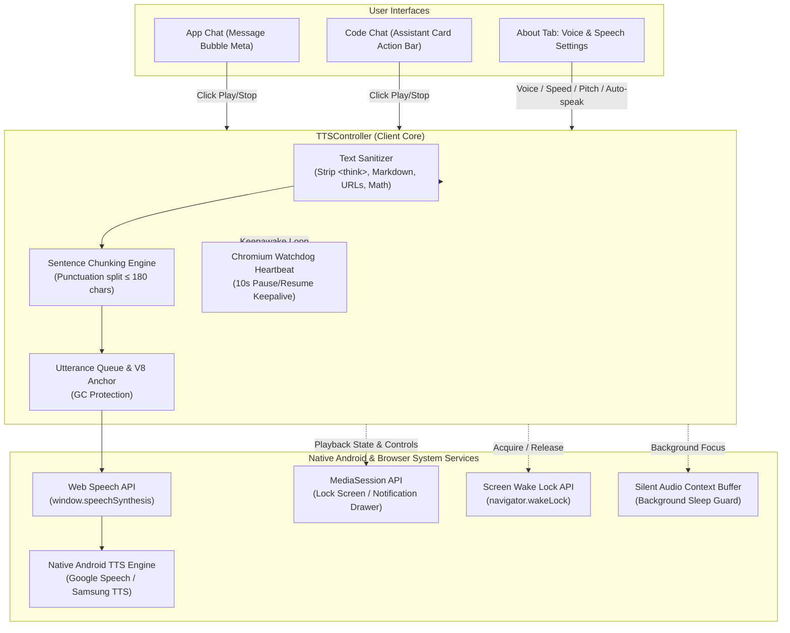

# Native Browser TTS Implementation Plan

## Goal Description
Implement a lightweight, high-performance, client-side Native Browser Text-to-Speech (TTS) system in D.L. AI / Strata that operates seamlessly in both **App Chat** (`#view-chat`) and **Code Chat** (`#view-code`).

The solution delivers audio playback across all target platforms:
1. **Desktop Google Chrome**
2. **Desktop Brave Browser**
3. **Desktop Chromium**
4. **Android Google Chrome**
5. **Android Brave Browser**
6. **Native Android System Solution** (via Web Speech API bridge to Android TextToSpeech engine, MediaSession lock screen playback controls, Screen Wake Lock, and background audio keep-alive).

All audio synthesis runs 100% locally on the client device using browser-native APIs (`window.speechSynthesis`, `SpeechSynthesisUtterance`). It requires zero external network requests, zero server compute overhead, and preserves absolute privacy.

---

## User Review & Key Decisions

- **Mobile & Brave Autoplay Policies**:
  Both Android browsers (Chrome & Brave) and Desktop Brave enforce strict user-gesture security policies. Audio playback cannot be started arbitrarily without prior user interaction.
  - **Manual Click-to-Speak**: Always succeeds across all platforms because it originates directly from a user tap/click.
  - **Auto-Read on Completion (Opt-in)**: Disabled by default (`false`) so speech never triggers unexpectedly in public environments. When enabled, the engine automatically primes and unlocks audio hardware during the initial prompt submission ("Send" tap). If the browser's privacy shield or mobile OS suspends autoplay, a gentle toast notifies the user without breaking execution.

- **Code Block Voicing Strategy**:
  Large source code listings sound jarring and unhelpful when read aloud character-by-character.
  The default replaces multi-line code blocks with a brief spoken cue: *"Code block omitted"*, while keeping the surrounding natural language explanation intact. An option in Settings allows users to select:
  1. **Skip code blocks (Default)**
  2. **Spoken summary** (*"Python code block, 12 lines"*)
  3. **Read verbatim** (Full code text)

---

## Architecture & Cross-Platform Engine Design

### Platform Compatibility & Workaround Matrix

| Target Platform | Known Browser Quirk / Limitation | Technical Mitigation in `TTSController` |
| :--- | :--- | :--- |
| **Desktop Chrome / Chromium** | **15s Speech Stall Bug**: Utterances >15s freeze silently without firing `onend` or `onerror`. | **Chunking + Watchdog**: Split text into sentences &le;180 chars; run 10s `pause()`/`resume()` heartbeat to reset watchdog. |
| **Desktop Chrome / Chromium** | **V8 Garbage Collection Sweep**: Utterances declared locally are freed mid-speech, abruptly cutting off audio. | **Permanent In-Memory Reference**: Maintain `TTSController.currentUtterance` set in global scope until `onend`. |
| **Desktop Chrome / Chromium** | **Async Voice Loading**: `getVoices()` returns empty array on initial frame. | **Dual Binding**: Listen to `window.speechSynthesis.onvoiceschanged` and re-query on user interaction. |
| **Desktop Brave Browser** | **Autoplay & Fingerprint Shields**: Brave blocks unprompted media and restricts remote cloud voices. | **Local Voices Priority**: Prefer `voice.localService === true`; prime audio on "Send" gesture; catch `NotAllowedError`. |
| **Android Chrome** | **Strict Touch Requirement**: Audio hardware locks if `speak()` is called without user touch context. | **Synchronous Gesture Unlock**: Initialize dummy utterance on first tap to unlock audio pipeline. |
| **Android Chrome & Brave** | **Screen Sleep Interruption**: Phone screen turns off after 30s of inactivity, suspending tab audio. | **Screen Wake Lock API**: Request `navigator.wakeLock.request('screen')` during playback; auto-release when done. |
| **Native Android System** | **Background App Switching**: Switching tabs or locking phone drops audio focus. | **MediaSession API**: Connect `navigator.mediaSession` metadata + playback actions (`play`, `pause`, `stop`) to Android notification drawer. |
| **Native Android System** | **Inter-Chunk Audio Drop**: Android audio HAL suspends pipeline between small sentence utterances. | **Silent WebAudio Buffer**: Play a microscopic silent audio loop via `AudioContext` during active session to preserve audio focus. |

---

## Proposed Changes

### Component 1: SVG Icons (`serve/web/sprite.svg`)
Add native Feather/Lucide styled `<symbol>` elements matching Strata's icon aesthetic:
- `<symbol id="i-volume">` (Speaker with sound waves).
- `<symbol id="i-volume-x">` (Speaker muted / stop state).

### Component 2: Core TTS Controller (`serve/web/app.js`)
Implement `TTSController` handling state, text sanitization, sentence chunking, watchdog timer, V8 GC retention, MediaSession, Screen WakeLock, and WebAudio keepalive buffer.

### Component 3: App Chat Integration (`serve/web/app.js`)
Add speaker button `[data-msg-speak]` to assistant messages, click delegation, and auto-speak trigger on turn completion.

### Component 4: Code Chat Integration (`serve/web/app.js` & `serve/web/index.html`)
Add Copy and Read Aloud action bar to mobile cards, quick `/speak` chip in composer, `/speak` slash command handler, and `#code-speak-btn` to desktop terminal action bar.

### Component 5: Settings & Preferences UI (`serve/web/index.html` & `serve/web/app.css`)
Add **Voice & Speech (TTS)** card inside the **About** tab with voice picker, speed slider, pitch slider, code block handling selector, auto-speak toggle, and test voice button.

---

## Verification Plan

### Automated Verification
1. **HTML & JavaScript Lint / Syntax Check**:
   `node --check serve/web/app.js`
2. **Text Sanitizer & Chunker Unit Tests**:
   `node tools/test_tts_sanitizer.js`

### Manual Cross-Platform Verification
1. Desktop Chrome & Chromium: Long answer test, watchdog keepalive, settings changes.
2. Desktop Brave: Shields compatibility, manual speak gesture, auto-speak fallback.
3. Android Chrome & Brave: Mobile touch gesture, screen lock playback, notification drawer controls.
4. Code Chat: Mobile card view action bar, desktop terminal toolbar button, `/speak` slash command.

---

## Sources

- [W3C Web Speech API Specification](https://wicg.github.io/speech-api/) — Official Web Speech API standard specification.
- [W3C Media Session Standard](https://w3c.github.io/mediasession/) — Standard for platform media notifications and lock screen integration.
- [W3C Screen Wake Lock API](https://w3c.github.io/screen-wake-lock/) — Screen wake lock interface specification.
- [Chromium Issue 679437 / 339023](https://issues.chromium.org/issues/40502120) — Chromium speech synthesis 15-second pause/freeze bug and watchdog workaround.
- User, chat, 2026-10-17.
