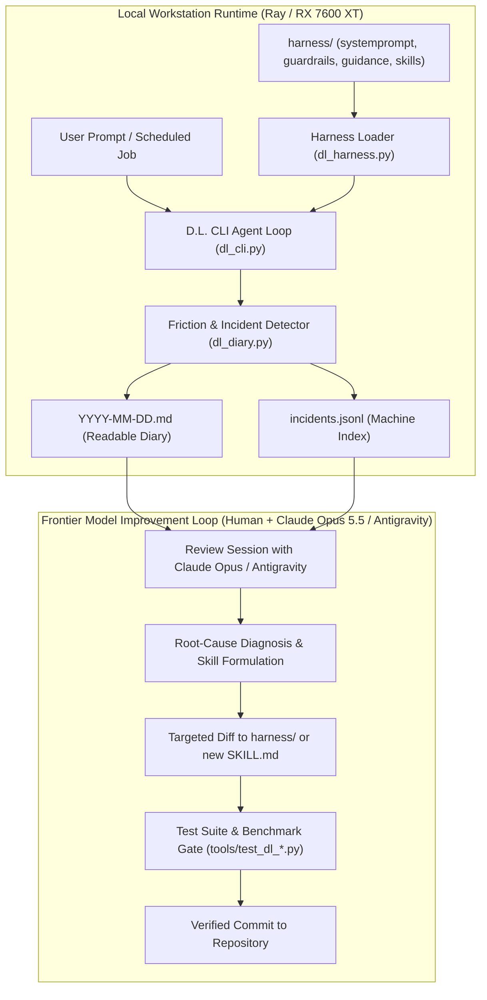
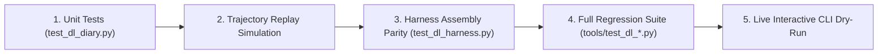

# Ray Struggle Diary and Modular Harness Implementation Plan

## Summary

This plan establishes an autonomous, local **Struggle & Incident Diary** for Ray (D.L. CLI) to continuously record friction, failures, inefficiencies, confusion, and unasked clarification gaps, coupled with a **Modular Harness-as-Files Architecture** that allows the user and frontier models (**Claude Opus 5.5** / **Antigravity**) to inspect evidence and craft clean, verified improvements.

Instead of letting a 1-bit quantized local model attempt hazardous self-modifications, we strictly decouple **telemetry** (Ray's runtime logging) from **harness engineering** (frontier model + human pair programming).



---

## Detailed Implementation Steps

### Phase 1: Autonomous Struggle & Incident Diary (`tools/dl_diary.py`)

#### 1.1 Friction Event Model & Categories
Define a structured `FrictionIncident` record in `tools/dl_diary.py`:
- **`FAILURE`**:
  - Tool result starts with `"Error"` or raises an exception.
  - Shell command exits with non-zero exit code (`[Command exited with code N]`).
  - Tool arguments cannot be parsed as JSON (`bad_args`).
  - Model emits plain-text pseudo-tool calls instead of native JSON tool calls.
- **`INEFFICIENCY`**:
  - Request exceeds 10 turns (`turn >= 10`).
  - Total tokens exceed 15,000 tokens for a single request.
  - Wall-clock time exceeds 180 seconds.
  - Duplicate/repeated tool calls with identical arguments (`call_sig in seen`).
- **`CONFUSION`**:
  - Checkpoint shrink alarm fired (emptied or halved a file).
  - Rapid undo/redo or editing the same target lines multiple times in one request.
  - Search queries returning empty results 3+ times in a row.
  - Mid-session context trimming occurred.
- **`UNASKED_CLARIFICATION`** *(High Priority)*:
  - User follow-up contains correction phrases: `"that's wrong"`, `"didn't work"`, `"why?"`, `"no, i meant"`.
  - Tool errors from non-existent paths where the model guessed file locations or IDs instead of asking the user or querying directory listings.
  - Ambiguous requests where the model picked an arbitrary option without confirming.
- **`INTERVENTION`**:
  - Sent back by Done Check (`DL_DONE_CHECK` stalled or uncompleted steps).
  - Sent back by Browser Check (`DL_BROWSER_CHECK` console errors found).
  - Sent back by Evidence Check (`DL_EVIDENCE` claims made without verification).
  - Sent back by Fresh-Context Reviewer (`DL_REVIEW` findings).

#### 1.2 Ledger Storage & File Structure
- **Directory**: `~/.local/state/dl-ai/diary/` (configurable via `DL_DIARY_DIR`).
- **Machine Index**: `~/.local/state/dl-ai/diary/incidents.jsonl` (single-line JSON per incident for programmatic analysis, filtering, and summarization).
- **Human/Frontier Daily Journal**: `~/.local/state/dl-ai/diary/YYYY-MM-DD.md`.
  - Grouped chronologically with clear visual badges.
  - Contains:
    - Timestamp, Task Prompt snippet, and Session ID.
    - Category tag(s) (`[FAILURE]`, `[UNASKED_CLARIFICATION]`, etc.).
    - Friction summary (e.g. *"Guessed entity ID `light.living_room` instead of listing entities"*).
    - What Ray should have asked the user.
    - Pointer to the exact transcript file for full inspection.

#### 1.3 Integration in `tools/dl_cli.py` & `tools/dl_sessiond.py`
- Hook `dl_diary.record_turn_event(...)` inside `execute_agent_loop` at tool dispatch and error points.
- Hook `dl_diary.record_request_summary(...)` at request completion, receiving:
  - `finish` state (changes, stalls, reviewer findings).
  - Total turns, total tokens, total wall-clock time.
  - Transcript path.
- Add `/diary` slash command to D.L. CLI and Web Code tab to display the last 5 incidents directly in the UI.

---

### Phase 2: Modular Harness-as-Files Architecture (`harness/`)

#### 2.1 Directory Structure
Create a clean directory in the repository root:
```
harness/
├── systemprompt.md      # Core persona, formatting rules, and execution loop
├── guardrails.md        # Invariant safety & clarification rules (e.g. "ask before guessing")
├── tool_guidance.md     # Specific dos and don'ts for existing tools
└── skills/              # On-demand specialist procedures
    ├── README.md
    ├── ha_area_move/
    │   └── SKILL.md     # How to move Home Assistant entities across areas
    └── proton_mail_report/
        └── SKILL.md     # Structured procedure for weather + proton reports
```

#### 2.2 Dynamic Assembler (`tools/dl_harness.py`)
- Reads the modular files and composes the final system prompt.
- **Zero-Failure Fallback**: If `harness/` is missing or corrupted, automatically falls back to the hardcoded default prompt in `dl_cli.py`.
- **Fast In-Memory Cache**: Uses `os.path.getmtime` checking so files are only re-read when modified on disk (< 0.1ms overhead).
- **Skill Activation Engine**: Exposes a lightweight `read_skill` tool or matches user intent to inject only the relevant `SKILL.md` into context on demand, keeping the baseline prompt at ~2,295 tokens.

---

### Phase 3: The Frontier Model / Human Improvement Workflow

When you want to improve Ray:
1. **Review Command**: Run `dl-cli diary` or pass `~/.local/state/dl-ai/diary/YYYY-MM-DD.md` to Claude Opus 5.5 / Antigravity.
2. **Analysis**: Claude Opus / Antigravity reads the diary and identifies recurring failure clusters.
3. **Drafting**: Claude Opus / Antigravity crafts a targeted change:
   - If Ray keeps guessing entity names: add an explicit rule in `harness/guardrails.md`.
   - If Ray encounters a complex recurring procedure: add a dedicated skill in `harness/skills/<name>/SKILL.md`.
   - If Ray formats tool calls poorly: refine `harness/tool_guidance.md`.
4. **Validation Gate**: Run the verification suite before applying the changes.

---

## Detailed Validation & Verification Steps



### Step 1: Unit Testing the Friction Detector (`tools/test_dl_diary.py`)
Create a dedicated unit test suite running without a model or GPU:
- **Test 1.1 (Failure Classification)**: Verify that non-zero exit codes, string `"Error: ..."`, and invalid JSON strings trigger the `FAILURE` classification.
- **Test 1.2 (Inefficiency Detection)**: Verify that a session with 11 turns or duplicate tool signatures triggers `INEFFICIENCY`.
- **Test 1.3 (Clarification Detection)**: Verify that user complaints (`"that's wrong"`, `"didn't work"`) or file-not-found loops trigger `UNASKED_CLARIFICATION`.
- **Test 1.4 (Intervention Recording)**: Verify that mock reviewer findings or browser console errors trigger `INTERVENTION`.
- **Test 1.5 (Atomic Writing & Formatting)**: Verify that `incidents.jsonl` and `YYYY-MM-DD.md` write safely without race conditions or file locking errors.

### Step 2: Trajectory Replay Simulation
- In `test_dl_diary.py`, simulate a multi-turn trajectory with a temporary workspace:
  - Turn 1: Model calls `view_file` on a non-existent path.
  - Turn 2: Model runs a bash command that exits with code 1.
  - Turn 3: User corrects the model with `"no, that file was in src/"`.
- Verify that the diary records a single cohesive incident capturing the unasked clarification gap and the command failure, with accurate transcript linkage.

### Step 3: Modular Harness Assembly Parity (`tools/test_dl_harness.py`)
- **Test 3.1 (Parity Check)**: Ensure that assembling `harness/systemprompt.md` + `guardrails.md` produces a system prompt that includes all critical sections (`<project_memory>`, environment context, Ray persona).
- **Test 3.2 (Missing File Fallback)**: Delete/rename the `harness/` folder in a mock environment; verify that `dl_harness.get_system_prompt()` falls back to `dl_cli.DEFAULT_SYSTEM_PROMPT` with zero crashes.
- **Test 3.3 (Skill Loading)**: Verify that calling a mock skill injects its `SKILL.md` content into active context without corrupting the conversation history.

### Step 4: Full Repository Regression Testing
Execute the entire existing suite of standalone tests:
- `python tools/test_dl_tool_calls.py` (Broken tool call handling)
- `python tools/test_dl_auto_raise.py` (Thinking level auto-raise)
- `python tools/test_dl_effort.py` (Effort selection and budget capping)
- `python tools/test_dl_sessiond.py` (Shared daemon communication)
- `python tools/test_dl_session_tools.py` (Session tools)
- `python tools/test_dl_memory.py` (Memory files & trim protection)
- `python tools/test_dl_yolo_continue.py` (YOLO rollover & cap)
- `python tools/test_dl_auditing.py` (Security scan & guardrails)

*All tests must pass with exit code 0.*

### Step 5: Live Interactive CLI & UI Verification
- Start a test session: `python tools/dl_cli.py`.
- Run an intentional friction command (e.g. asking Ray to inspect a non-existent directory).
- Verify that the diary records the incident in `~/.local/state/dl-ai/diary/`.
- Run `/diary` in the CLI and check that the incident appears formatted with its badge and symptom summary.
- Verify that the Cloudflare Web Code tab displays the diary notice cleanly without UI glitches.

## Sources

1. User, chat, 2026-10-24.
2. arXiv:2610.14224v1 (Harness²: Recursive Agent Harnessing for an Open World, Google Cloud AI Research, 2026).
3. GitHub google-research/harness2 (2026).
