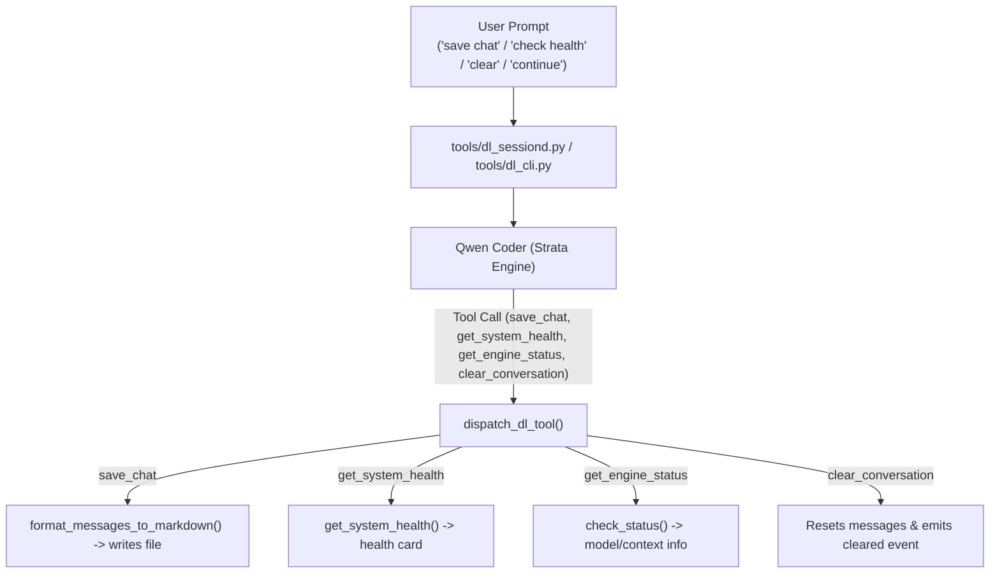

# Implementation Plan: Session Tools & Conversational Continue

This plan implements autonomous session management tools and conversational `/continue` handling in Strata (D.L. CLI and Web GUI session daemon).

---

## 1. Objectives

1. **Individual Session Tools in `DL_TOOLS`**:
   - `save_chat`: Allows the model to save the conversation as Markdown into the workspace on request (e.g., "save this chat", "export session as notes.md").
   - `get_system_health`: Allows the model to query real-time CPU, RAM, VRAM, Swap, GPU usage and hardware metrics.
   - `get_engine_status`: Allows the model to inspect Strata engine status, loaded model, context window, and props.
   - `clear_conversation`: Allows the model to reset conversation memory immediately when asked.

2. **Conversational Continue Handling**:
   - When the agent loop stops at `DL_MAX_TURNS`, conversational prompts like `"continue"`, `"keep going"`, `"go on"`, `"proceed"` are automatically treated as `/continue`.

3. **YOLO Mode Auto-Continue**:
   - In `/yolo` mode, reaching the turn cap resets the turn counter and loops indefinitely until the goal is achieved or the user interrupts.

4. **Tool Dispatch & Session Daemon Integration**:
   - Wire tool execution in `tools/dl_cli.py:dispatch_dl_tool` and `tools/dl_sessiond.py`.
   - Update tests in `tools/test_dl_session_tools.py` and `tools/test_dl_yolo_continue.py`.

---

## 2. Technical Architecture

---

## 3. Step-by-Step Implementation

1. **Tool Definitions (`tools/dl_cli.py`)**:
   - Added `save_chat`, `get_system_health`, `get_engine_status`, and `clear_conversation` to `DL_TOOLS` and `DL_PLAN_TOOLS` (`save_chat` & `clear_conversation` in Act mode, `get_system_health` & `get_engine_status` in both Plan and Act modes).
2. **Tool Dispatcher (`tools/dl_cli.py`)**:
   - Implemented handlers in `dispatch_dl_tool()`.
3. **Session Daemon Integration (`tools/dl_sessiond.py`)**:
   - Supported `clear_conversation` callback from `session_context`.
   - Added conversational continue detection in `_command()` when turn cap was reached.
4. **CLI Integration (`tools/dl_cli.py`)**:
   - Added conversational continue detection in interactive loop and YOLO auto-continue without prompts.
5. **Testing & Verification**:
   - Unit test suites: `tools/test_dl_session_tools.py` (6 tests) and `tools/test_dl_yolo_continue.py` (2 tests).

---

## Related

- [Shared CLI Session Daemon for Web and Terminal](../decisions/shared-cli-session-daemon.md)
- [Home Assistant Server and Session Tools Walkthrough](homeassistant-and-session-tools-walkthrough.md)

## Sources

1. Antigravity, conversation 47cce368-ea13-4d3f-901b-2a9f88797c15, 2026-10-17.
