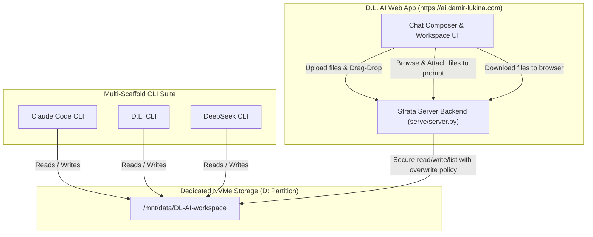

# Shared Workspace Implementation Plan (`/mnt/data/DL-AI-workspace`)

This plan implements a shared workspace directory on the dedicated storage partition (`/mnt/data/DL-AI-workspace`), tightly integrating the **Claude Code CLI**, **D.L. CLI**, **DeepSeek CLI**, and the **D.L. AI Web App** (`https://ai.damir-lukina.com/`).

---

## Architecture & Data Flow

---

## 1. Shared Storage Setup
- **Directory**: `/mnt/data/DL-AI-workspace`
- **Permissions**: `0755`, owned by `damirl:damirl`.
- Directory auto-created on service startup if missing.

---

## 2. CLI Default Integration
- **Target File**: `tools/run-code-session.sh` & user shell configuration.
- **Behavior**:
  - Automatically pins working directory to `/mnt/data/DL-AI-workspace`.
  - All CLIs operate on this shared tree with full read/write access.

---

## 3. Backend Endpoints (`serve/server.py`)
- Authenticated, path-traversal-protected workspace endpoints:
  - `GET /api/workspace/files`: Lists files recursively with relative paths, sizes, and timestamps.
  - `GET /api/workspace/file?path=...`: Retrieves file content.
  - `POST /api/workspace/file`: Creates or updates a file.
  - `DELETE /api/workspace/file`: Deletes a file.

## Sources
- `tools/run-code-session.sh` — Multi-scaffold runner script and working directory configuration.
- `serve/server.py` — Workspace file browser, upload, and deletion API endpoints.
- [Shared Workspace on Dedicated Storage](../decisions/shared-workspace-d-disk.md) — Architecture decision.

