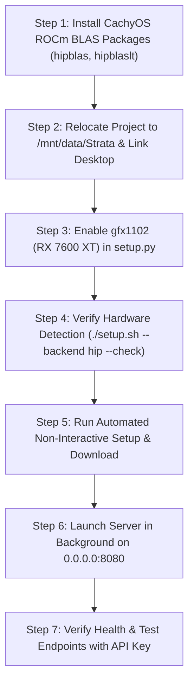

# Tailored Strata Deployment Plan for CachyOS Linux

This deployment plan has been finalized based on your hardware configuration and interview choices.

---

## 1. User Choices & Deployment Architecture

| Configuration Parameter | Selected Choice | Technical Detail |
| :--- | :--- | :--- |
| **Model Family & Size** | **Qwen3.8-Flash-Next Coder (`IQ1_M`)** | 256 retained experts, 29.6 GB main shard, tailored for coding agents & 32 GB RAM. |
| **Install & Storage Path** | **`/mnt/data/Strata`** (D: partition, NVMe) | High-capacity partition with **460 GB free**, linked seamlessly to `~/Desktop/Strata`. |
| **Vision / Image Understanding** | **Enabled (`--vision cpu`)** | Compiles/configures the CPU vision encoder (~1.5 GB download) to inspect images in chat. |
| **Network & Security** | **LAN Expose (`0.0.0.0:8080`) with API Key** | Protected by generated secret key: `STRATA_API_KEY`. |
| **GPU Target & Acceleration** | **AMD Radeon RX 7600 XT (`gfx1102`)** | 16 GB VRAM; compiled natively via ROCm 7.2.4 using HIP backend. |

---

## 2. Step-by-Step Execution Plan



### Step 1: System Package Prerequisites
Install the missing HIP development libraries (`hipblas` and `hipblaslt`) using CachyOS's package manager so `cmake` and `hipcc` link against system libraries without needing TheRock wheels:
```bash
sudo pacman -S --needed hipblas hipblaslt
```

### Step 2: Relocate Installation to `/mnt/data/Strata`
To keep all repository files, compiled engine binaries, virtual environment, and ~35 GB of model weights on your 460 GB partition:
```bash
# 1. Copy the Strata repository to /mnt/data/Strata
cp -a /home/damirl/Desktop/Strata /mnt/data/Strata

# 2. Re-point Desktop folder to the /mnt/data installation
rm -rf /home/damirl/Desktop/Strata
ln -s /mnt/data/Strata /home/damirl/Desktop/Strata
cd /mnt/data/Strata
```

### Step 3: Enable `gfx1102` in `setup.py`
In `/mnt/data/Strata/setup.py`, add `gfx1102` to the supported AMD architectures:
1. In `ROCM_INDEXES`:
   ```python
   "gfx1102": "https://rocm.nightlies.amd.com/v2/gfx110X-dgpu/",
   ```
2. In `AMD_ARCHS`:
   ```python
   AMD_ARCHS = ("gfx1100", "gfx1101", "gfx1102", "gfx1200", "gfx1201", "gfx1030", "gfx1031")
   ```
3. In `AMD_NAMES`:
   ```python
   "gfx1102": "AMD Radeon RX 7600 XT (gfx1102)",
   ```

### Step 4: Verification Check
Execute setup's read-only hardware audit:
```bash
./setup.sh --backend hip --check
```
*Expected output:* Confirms GPU 0 is `AMD Radeon RX 7600 XT (gfx1102)` with `16.0 GB VRAM` and ROCm ready.

### Step 5: Automated Installation & Model Download
Run the setup command non-interactively with your exact interview parameters:
```bash
./setup.sh --backend hip --yes \
  --family coder \
  --vision cpu \
  --host 0.0.0.0 \
  --api-key STRATA_API_KEY \
  --no-start
```

**What happens during this command:**
- Configures `build-hip/` and compiles `strata` and `strata-vision` for `gfx1102` (~10–15 minutes).
- Downloads the Coder model weights (`IQ1_M`, ~30–35 GB) and vision encoder (~1.5 GB) into `/mnt/data/Strata-data`.
- Automatically generates the startup script `run-coder-iq1_m.sh`.

> [!NOTE]
> If your network drops or is interrupted, simply rerun the exact same command. Hugging Face downloads and build artifacts resume where they left off.

---

### Step 6: Launch Strata in Background
Start the inference server in the background:
```bash
nohup ./run-coder-iq1_m.sh > strata-server.out 2>&1 &
```
> [!WARNING]
> During the first launch, the engine will map ~29.6 GB of weights into host RAM and lock GPU memory buffers. The machine may be temporarily sluggish for 60–90 seconds while weights are pinned into memory.

---

### Step 7: Verify Deployment

1. **Verify Server Health:**
   ```bash
   curl -s http://127.0.0.1:8080/health \
     -H "Authorization: Bearer STRATA_API_KEY"
   ```
2. **Test Generation via API:**
   ```bash
   curl -s http://127.0.0.1:8080/v1/chat/completions \
     -H "Content-Type: application/json" \
     -H "Authorization: Bearer STRATA_API_KEY" \
     -d '{"model": "strata", "messages": [{"role": "user", "content": "Write a python quicksort function"}], "max_tokens": 128, "reasoning_effort": "none"}'
   ```

---

## 3. Client & Remote Device Access

Because the server is bound to `0.0.0.0:8080` with an API key, you can connect from:

- **Local Browser:** `http://127.0.0.1:8080` (enter API key in the settings modal when prompted).
- **Remote Devices / Phones on Local Network:** `http://<your-pc-ip>:8080`.
- **OpenAI-Compatible Tools (Cursor, Continue, VS Code):**
  - Base URL: `http://127.0.0.1:8080/v1` (or your LAN IP)
  - API Key: `STRATA_API_KEY`
  - Model: `strata`
- **Claude Code CLI:**
  ```bash
  export ANTHROPIC_BASE_URL="http://127.0.0.1:8080"
  export ANTHROPIC_AUTH_TOKEN="STRATA_API_KEY"
  ```

## Sources
- **Tool:** Antigravity AI Assistant
- **Session ID:** 44aeb44c-4179-41a4-b503-f0e55de2e0a8
- **Date:** 2026-10-10
