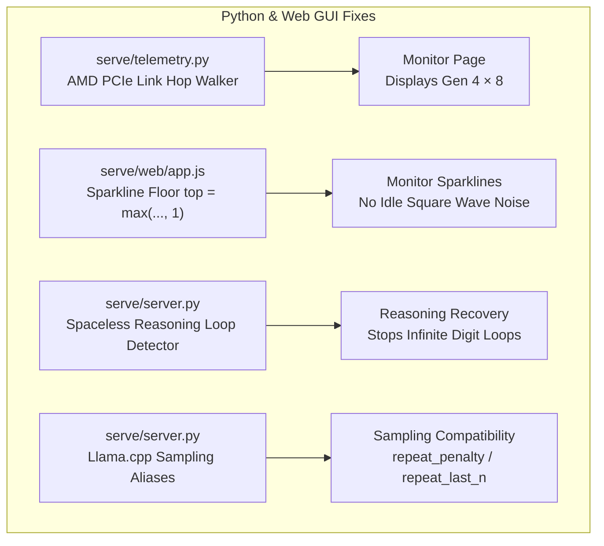

# Upstream v0.1.42 Fixes Integration Plan

This plan details the integration of the upstream **Strata v0.1.42** updates into the local Strata installation on CachyOS Linux (AMD Ryzen 5 3600, 32 GB RAM, AMD Radeon RX 7600 XT 16 GB, `gfx1102`).

---

## Goal Description

Upstream released **v0.1.42**, bringing several bugfixes and telemetry enhancements. The objective was to cherry-pick and integrate the relevant fixes that benefit your specific AMD hardware and server setup, while **strictly preserving** all custom features developed for your installation:
- Authenticated Claude Code CLI Web Terminal (`#tab-btn-code`, `ttyd` proxy, WebSocket raw tunneling, tmux session persistence).
- Shared Server Workspace (`/mnt/data/DL-AI-workspace`) with recursive N-ary collapsible tree structure and drag-and-drop.
- Pre-seeded API authentication, custom dark theme, lazy loading with auto-unload, and mobile GUI responsive styling.

---

## Integrated Components

### 1. AMD Linux PCIe Telemetry (`serve/telemetry.py`)
- **Upstream Commit**: `7f3c0da2`
- **Issue**: `_Amd.read()` previously only read GPU utilization, VRAM usage/total, temperature, and power, returning dashes for PCIe generation and lane width.
- **Fix**: Added sysfs hop walker to discover the narrowest link between the PCIe root port and the GPU, returning `pcie_gen` and `pcie_width`.
- **Result**: RX 7600 XT accurately reports **Gen 4 × 8** (or Gen 3 x 8 under current slot negotiation).

### 2. Sparkline Noise Floor (`serve/web/app.js`)
- **Fix**: Replaced dynamic zero-floor with `const top = Math.max(Math.ceil(max * 1.15), 1)`.
- **Result**: Eliminates erratic full-height square-wave rendering when metrics hover at true 0.

### 3. Spaceless Reasoning Loop Detector (`serve/server.py`)
- **Fix**: Implemented tracking of continuous non-whitespace characters inside `<think>` tokens. If 200+ continuous digits/letters occur without a space, generation safely terminates.

### 4. Llama.cpp Sampling Aliases (`serve/server.py`)
- **Fix**: Mapped `repeat_penalty` to `frequency_penalty` and `repeat_last_n` to `presence_penalty` in `openai_to_messages`.

---

## Sources

- Tool: Antigravity pair programming session
- Session ID: `44aeb44c-4179-41a4-b503-f0e55de2e0a8`
- Date: 2026-10-10
