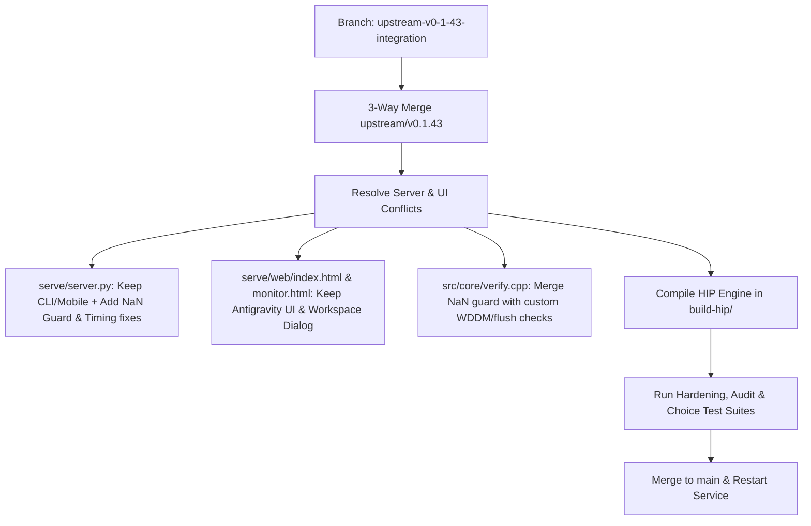

# Upstream Strata v0.1.43 Selective Integration Plan

## Goal Description
Upstream Strata released version **v0.1.43** (including v0.1.41.1, v0.1.42.1, and v0.1.43). The upstream update contains major C++/HIP/CUDA engine performance enhancements (warp-level route-resident swaps, pinned prefill buffers, non-finite logit self-healing NaN guard, AMD gfx12 tuning tables), as well as server resilience improvements (slot timing accounting, context overflow detection, clean process exit cache drops, and the official benchmark suite).

The goal is to cleanly integrate these high-value engine and server upgrades into our fork (`main`) while strictly preserving:
1. **Custom Web GUI & Aesthetics**: Antigravity 2.0 Dark GUI aesthetic with orange accent (`tokens.css`), Server Workspace manager dialog (`workspace-dialog`), and Force Restart controls.
2. **Unified Flagship CLI & Companion Mode**: Single `CLI` scaffold with touch chip bar (`/exa`, `/context7`, `/health`, `/status`, `/plan`, `/act`), live ANSI-stripped companion feed, and Markdown chat exporter.
3. **Security & Guardrails**: Path containment (`safe_workspace_path`), CSRF validation on restarts (`_own_page`), unclosed file descriptor protections in telemetry, and leak scanner.

---

## Strategy & Conflict Resolution

### Conflict Points Resolved:
- `serve/server.py`: Preserved custom endpoints (`/api/workspace`, CLI companion state) and integrated upstream NaN guard and slot timing fixes.
- `serve/telemetry.py`: Preserved memory leak guardrails and file descriptor leak fixes.
- `serve/web/index.html` & `serve/web/monitor.html`: Preserved dark theme tokens and workspace modal.
- `src/core/verify.cpp`: Merged upstream NaN guard and warp swap kernels with custom low-latency exit checks.

---

## Verification Plan
1. Compile HIP engine binary on ROCm via Ninja/CMake (`[294/294]` targets).
2. Execute full test suites:
   - `serve/test_request_hardening.py`: 10/10 passed.
   - `tools/test_setup_choices.py`: 47/47 passed.
   - `tools/test_setup_amd.py`: 36/36 passed.
   - `tools/test_dl_auditing.py`: 12/12 passed.
3. Verify live JIT inference and warm completions via `/v1/chat/completions`.

## Related
- Walkthrough: [Strata v0.1.43 Integration and Optimization Walkthrough](strata-v0-1-43-integration-and-optimization-walkthrough.md)
- Optimization Matrix: [Strata v0.1.43 Optimization and Benchmarking Matrix](v0-1-43-optimization-benchmark-report.md)
- Entity: [Strata](../entities/strata.md)

## Sources
- Upstream Strata `v0.1.43` tag and commits
- Session planning and execution, 2026-10-11
